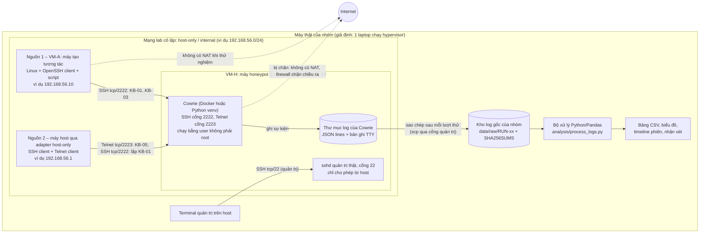
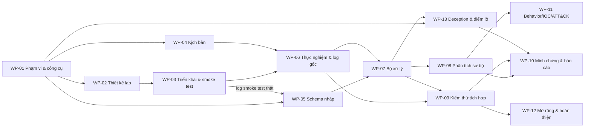

# Kế hoạch báo cáo tiến độ – Đề tài 13: Honeypot thu thập và phân tích hành vi tấn công

NT140 – An toàn mạng (UIT) · Nhóm 4 thành viên (TV1–TV4) · Bản kế hoạch đầu, lập ngày 04/11/2026

> **Tính chất tài liệu.** Đây là sản phẩm lập kế hoạch. Trong quá trình lập tài liệu này chưa có hệ thống nào được triển khai, chưa chạy lệnh trên lab và chưa thu log nào. Mọi sơ đồ, bảng trường dữ liệu, kịch bản, tên file/thư mục bên dưới là **bản nháp hoặc quy ước đề xuất**, không phải minh chứng hệ thống đã chạy. Tiến độ thật của nhóm chưa được cung cấp nên được giữ ở dạng **[CẦN BỔ SUNG]** hoặc **chưa xác nhận**.

**Ký hiệu nguồn dùng trong tài liệu**

| Ký hiệu | Ý nghĩa |
| --- | --- |
| **[YC]** | Yêu cầu của người dùng trong prompt lập kế hoạch |
| **[ĐT]** | Nội dung đề tài trong ảnh (qua file `THONG_TIN_MON_HOC_NT140.md`) |
| **[PDF]** | Thông tin từ slide môn học, kèm tên file và số trang PDF (đã mở đối chiếu) |
| **[ĐX]** | Đề xuất của người lập kế hoạch, nhóm có thể điều chỉnh |
| **[CT]** | Đã đối chiếu tài liệu chính thức của công cụ hoặc MITRE ATT&CK (link ở Phụ lục) |
| **[XM]** | Cần xác minh thêm trên máy/phiên bản thực tế trước khi dùng |
| **[CẦN BỔ SUNG]** | Thông tin tiến độ nhóm chưa cung cấp |

**Mục lục:** A. Định hướng · B. Nhóm đã làm được tới đâu · C. Bộ kết quả cơ bản · D. Phương án kỹ thuật · E. Kế hoạch theo giai đoạn · F. Phân công · G. Minh chứng · H. Thử nghiệm và phân tích · I. Khung buổi báo cáo · Tự rà soát · Phụ lục nguồn

---

## A. Định hướng đề tài

**Bài toán.** Honeypot là hệ thống mồi không phục vụ người dùng hợp lệ, nên mọi tương tác với nó đều đáng quan sát. Đề tài yêu cầu hiểu nguyên lý deception và cách honeypot tạo security telemetry phục vụ nghiên cứu hành vi attacker [ĐT]. Việc cụ thể của nhóm: dựng một honeypot trong lab có kiểm soát, tạo tương tác, thu log và biến log thành dữ liệu phân tích được theo nguồn, dịch vụ đích, thao tác và diễn biến (timeline) [ĐT].

**Giá trị học thuật và liên hệ môn học** (chỉ nêu điểm dùng trực tiếp):

- Đề tài thuộc nhánh phòng vệ: Lecture 11 "Network Defenses: Firewalls, IDPS, Honeypot overview" [PDF: L01, tr.8]. Trong chuỗi Prevent → Detect → Recover/Mitigate [PDF: L02, tr.6–7], honeypot đóng góp ở khâu Detect và giúp hiểu đối tượng tấn công.
- Threat modeling hỏi attacker là ai, động cơ và năng lực gì [PDF: L02, tr.24]. Dữ liệu honeypot giúp mô tả hành vi bằng quan sát thay vì phỏng đoán.
- Thiết kế lab áp dụng least privilege, privilege separation, defense in depth và fail closed [PDF: L02, tr.25–29; 04-principles_os_sec, tr.11–15].
- Phân tích nguồn kết nối dựa trên kiến thức TCP/IP [PDF: L05, tr.21]. Slide cũng nêu địa chỉ nguồn có thể bị giả mạo [PDF: L05, tr.33, 35], nên **không quy kết danh tính attacker từ source IP**.
- Hành vi tải tệp hoặc điều khiển từ xa liên hệ với malware/botnet [PDF: L04, tr.12, 30], nhưng không kết luận có malware chỉ từ vài lệnh.
- Hash dùng để bảo toàn log gốc và định danh tệp thu được [PDF: L03, tr.35–36]. Nếu cần kiểm chứng ở tầng gói tin, có thể dùng tcpdump/Wireshark (PCAP) [PDF: L06, tr.18; L05, tr.34], nhưng đây là tùy chọn.

**Câu hỏi dữ liệu có thể trả lời** [ĐX]:

- **Q1.** Với từng loại tương tác (kết nối, đăng nhập, thao tác sau đăng nhập), honeypot ghi nhận được gì và chi tiết tới đâu? Thao tác nào không để lại dấu vết, và phản hồi nào của honeypot làm lộ đây là hệ thống giả?
- **Q2.** Từ log có dựng lại được diễn biến một phiên (kết nối từ đâu, thử gì, làm gì, theo thứ tự nào, kéo dài bao lâu) và đối chiếu khớp với kịch bản thực tế không?
- **Q3.** Có thể trích xuất những chỉ dấu nào (credential, lệnh, URL, hash) và phân loại thành nhóm hành vi nào? Tới mức nào thì đủ căn cứ để mapping MITRE ATT&CK?

**Đích đến toàn đề tài và phạm vi buổi báo cáo tiến độ** [ĐX, dựa trên YC]:

| | Đích đến toàn đề tài | Phạm vi buổi báo cáo tiến độ gần nhất |
| --- | --- | --- |
| Deception | Trình bày được honeypot tạo mồi và sinh telemetry ra sao; phân tích điểm lộ của mồi từ dữ liệu thật | Ghi chú nguyên lý deception và telemetry; 1–2 quan sát điểm lộ từ KB-03 nếu đã có log |
| Thu thập | Honeypot chính với hai dịch vụ (SSH, Telnet), tương tác từ hai nguồn, nhiều kịch bản; có thể thêm honeypot thứ hai (OpenCanary) | Lab cơ bản chạy được, có ít nhất một lượt thử nghiệm kiểm soát với log thực (nếu chưa đạt thì báo đúng phần đã đạt và lỗi còn vướng) |
| Xử lý | Quy trình chạy lại được từ log gốc tới bảng kết quả | Bảng dữ liệu chuẩn hóa bước đầu, truy ngược được về log gốc |
| Phân tích | Phân tích nguồn, dịch vụ, lệnh, timeline; phân loại behavior; IOC có ngữ cảnh; ATT&CK có bằng chứng | Một vài bảng/biểu đồ có ý nghĩa, timeline một phiên, nhận xét ban đầu kèm giới hạn |
| Đầu ra | Security report đơn giản theo mẫu H.9, có thể kèm dashboard [ĐT] | Chưa cần dashboard; cần bộ minh chứng trung thực và kế hoạch tiếp theo [YC] |

---

## B. Nhóm đã làm được tới đâu – tiến độ và kết quả hiện tại

### B.1. Thông tin đang có tại thời điểm lập kế hoạch

- Cả 7 mục tiến độ trong prompt đều ở trạng thái **[CHƯA CUNG CẤP]**. Vì vậy tài liệu **không tự gán giai đoạn hay thành tích** cho nhóm.
- Thư mục làm việc hiện có: 7 file PDF slide môn học, file tổng hợp `THONG_TIN_MON_HOC_NT140.md` (mục tiêu môn học, đánh giá, nội dung đề tài 13, có dẫn trang) và file prompt lập kế hoạch. Thư mục `Project/` **đang trống**. Thư mục trống **không chứng minh** nhóm chưa làm gì, vì sản phẩm có thể đang nằm ở nơi khác.
- Hạng mục duy nhất có minh chứng nhìn thấy được là **tổng hợp thông tin môn học và nội dung đề tài** (file `THONG_TIN_MON_HOC_NT140.md`). Người thực hiện và việc nhóm đã thống nhất nội dung này hay chưa: chưa xác nhận.

### B.2. Đoạn khái quát (mẫu, điền vào chỗ trống)

> Hiện nhóm đang ở giai đoạn **[CẦN BỔ SUNG: xác định phạm vi / chọn công cụ / thiết kế lab / đã dựng lab / đã thu log thử / đã phân tích bước đầu]**. Nhóm đã tổng hợp thông tin môn học và nội dung đề tài 13 thành một ghi chú có dẫn nguồn trang **[CẦN BỔ SUNG: người thực hiện]**. Về công cụ, nhóm **[CẦN BỔ SUNG: đã chốt / đang cân nhắc]** **[tên công cụ]** vì **[lý do]**. Phần mới ở mức thiết kế gồm **[CẦN BỔ SUNG]**; phần đã chạy thử hoặc kiểm chứng gồm **[CẦN BỔ SUNG, ghi "chưa có" nếu chưa chạy]**. Vướng mắc chính hiện tại là **[CẦN BỔ SUNG]**.

### B.3. Bảng tiến độ hiện tại

| Hạng mục | Việc thực tế đã thực hiện | Kết quả/sản phẩm hiện có | Mức độ hoàn thành | Minh chứng/nguồn xác nhận | Thành viên | Phần còn thiếu/vướng mắc |
| --- | --- | --- | --- | --- | --- | --- |
| 1. Xác định bài toán/phạm vi | Tổng hợp thông tin môn học và đề tài; [CẦN BỔ SUNG: đã chốt câu hỏi/phạm vi chưa] | `THONG_TIN_MON_HOC_NT140.md` | Tổng hợp bối cảnh: có file. Chốt câu hỏi/phạm vi: chưa xác nhận | File trong thư mục làm việc | [CẦN BỔ SUNG] | Chưa có bản chốt câu hỏi nghiên cứu và phạm vi được cả nhóm thống nhất (chưa xác nhận) |
| 2. Nghiên cứu và chọn công cụ | [CẦN BỔ SUNG] | [CẦN BỔ SUNG] | Chưa xác nhận | [CẦN BỔ SUNG] | [CẦN BỔ SUNG] | [CẦN BỔ SUNG] |
| 3. Thiết kế lab | [CẦN BỔ SUNG] | [CẦN BỔ SUNG] | Chưa xác nhận | [CẦN BỔ SUNG] | [CẦN BỔ SUNG] | [CẦN BỔ SUNG] |
| 4. Cài đặt/cấu hình | [CẦN BỔ SUNG] | [CẦN BỔ SUNG] | Chưa xác nhận | [CẦN BỔ SUNG] | [CẦN BỔ SUNG] | [CẦN BỔ SUNG] |
| 5. Tạo tương tác và thu log | [CẦN BỔ SUNG] | [CẦN BỔ SUNG] | Chưa xác nhận | [CẦN BỔ SUNG] | [CẦN BỔ SUNG] | [CẦN BỔ SUNG] |
| 6. Xử lý/phân tích | [CẦN BỔ SUNG] | [CẦN BỔ SUNG] | Chưa xác nhận | [CẦN BỔ SUNG] | [CẦN BỔ SUNG] | [CẦN BỔ SUNG] |
| 7. Thống kê/báo cáo | [CẦN BỔ SUNG] | [CẦN BỔ SUNG] | Chưa xác nhận | [CẦN BỔ SUNG] | [CẦN BỔ SUNG] | [CẦN BỔ SUNG] |
| 8. Phối hợp nhóm | [CẦN BỔ SUNG: đã phân vai chưa, kênh trao đổi, nơi lưu chung] | [CẦN BỔ SUNG] | Chưa xác nhận | [CẦN BỔ SUNG] | [CẦN BỔ SUNG] | [CẦN BỔ SUNG] |

### B.4. Hướng dẫn điền bảng B.3

Mỗi hạng mục chỉ được ghi trạng thái khi có căn cứ. Cột "Minh chứng cần có" là thứ nhóm nên đính kèm để chứng minh trạng thái đã ghi.

| Hạng mục | Ghi "đã hoàn thành" khi | Ghi "đang làm" khi | Minh chứng cần có |
| --- | --- | --- | --- |
| 1. Bài toán/phạm vi | Có văn bản chốt câu hỏi Q1–Q3 (hoặc tương đương), phạm vi trong/ngoài, cả nhóm đã đọc | Có bản nháp, chưa thống nhất | File ghi chú, lịch sử chỉnh sửa hoặc biên bản trao đổi |
| 2. Chọn công cụ | Có bảng so sánh và quyết định chính/dự phòng có lý do, đối chiếu tài liệu chính thức | Mới đọc tài liệu hoặc đang so sánh | Bản ghi quyết định, link tài liệu chính thức đã đọc |
| 3. Thiết kế lab | Có sơ đồ với máy/VM, IP, cổng, nơi lưu log, chính sách cách ly | Có phác thảo, chưa đủ thông số | File sơ đồ |
| 4. Cài đặt/cấu hình | Honeypot khởi động được và nhận kết nối thử từ máy lab | Đang cài, gặp lỗi | Ảnh màn hình, cấu hình đã bỏ thông tin nhạy cảm, log khởi động, lỗi gặp phải |
| 5. Tương tác và log | Có ít nhất một tương tác kiểm soát truy ngược được sang sự kiện trong log gốc | Đã kết nối nhưng chưa đối chiếu log | Log gốc, nhật ký thử nghiệm, bảng đối chiếu |
| 6. Xử lý/phân tích | Có bảng dữ liệu chuẩn hóa sinh ra từ log thực bằng cách chạy lại được | Có mã/notebook nhưng chưa chạy trên log thực | Mã, file đầu ra, ghi chú cách chạy |
| 7. Thống kê/báo cáo | Có ít nhất một bảng/biểu đồ từ dữ liệu thực kèm nhận xét và giới hạn | Có bảng/biểu đồ từ dữ liệu minh họa | File kết quả, ghi rõ nguồn dữ liệu |
| 8. Phối hợp nhóm | Đã chốt vai trò, nơi lưu chung và quy trình review | Đang trao đổi | Bảng phân công, thư mục/repo chung |

Quy tắc khi điền:

- Đã chọn công cụ không có nghĩa là đã cài. Cài chạy được không có nghĩa là đã thu log. Có log không có nghĩa là đã phân tích.
- Việc nhóm xác nhận đã làm nhưng chưa gửi minh chứng: ghi "theo thông tin nhóm cung cấp, chưa có minh chứng đính kèm".
- Việc mới ở mức nghiên cứu/thiết kế: ghi cụ thể nội dung đã tổng hợp, lựa chọn đã chốt, sơ đồ hoặc kịch bản đã có. Không ghi thành kết quả thực nghiệm.
- Không tự tính phần trăm hoàn thành.

### B.5. Đóng góp đã thực hiện tới hiện tại (tách khỏi phân công tương lai ở mục F)

| Thành viên | Việc đã làm | Sản phẩm/minh chứng | Ghi chú |
| --- | --- | --- | --- |
| TV1 | [CẦN BỔ SUNG] | [CẦN BỔ SUNG] | |
| TV2 | [CẦN BỔ SUNG] | [CẦN BỔ SUNG] | |
| TV3 | [CẦN BỔ SUNG] | [CẦN BỔ SUNG] | |
| TV4 | [CẦN BỔ SUNG] | [CẦN BỔ SUNG] | |
| Chưa rõ người thực hiện | Tổng hợp thông tin môn học và đề tài | `THONG_TIN_MON_HOC_NT140.md` | Cần xác nhận người làm |

### B.6. Chốt mục B

- **Kết quả có thể trình bày ngay:** bối cảnh đề tài và liên hệ môn học (có file tổng hợp); thiết kế và kế hoạch dự kiến trong tài liệu này, trình bày đúng tính chất là thiết kế. Cộng thêm [CẦN BỔ SUNG: mọi việc nhóm đã làm thật].
- **Giới hạn hiện tại:** chưa xác nhận lựa chọn công cụ, lab, log hay phân tích. Chưa có minh chứng thực nghiệm nào được cung cấp.
- **Việc cần làm tiếp để sang bước kế tiếp:** (1) cả nhóm điền B.3 và B.5 kèm minh chứng (Giai đoạn 0, mục E); (2) đối chiếu với bộ kết quả cơ bản ở mục C để biết còn thiếu gì; (3) bắt đầu từ gói việc đầu tiên chưa đạt trong thứ tự WP-01 → WP-03 → WP-06.

---

## C. Những phần cần hoàn thành ở mức cơ bản để có kết quả báo cáo

Đây là **bộ mục tiêu chuẩn bị do người lập kế hoạch đề xuất [ĐX]**, không phải rubric chính thức của giảng viên và không phải danh sách việc nhóm đã làm. Trạng thái hiện tại của cả 6 hạng mục theo mục B: **chưa xác nhận** (riêng C1 đã có phần tổng hợp bối cảnh). Mã gói việc (WP-xx) tham chiếu mục E.

### C1. Chốt bài toán, phạm vi, công cụ và nguyên lý deception

| Trường | Nội dung |
| --- | --- |
| Mức cơ bản | Một ghi chú 1–2 trang: câu hỏi Q1–Q3 (hoặc bản nhóm sửa), hành vi muốn quan sát, phạm vi trong/ngoài, công cụ chính và dự phòng kèm lý do. Thêm một ghi chú 1–2 trang về nguyên lý deception và cách honeypot sinh telemetry (WP-13) |
| Các bước | (1) TV4 chốt câu hỏi và phạm vi từ mục A; (2) TV1 đọc tài liệu chính thức Cowrie/OpenCanary và trả lời các câu hỏi ở WP-01; (3) TV2 xác nhận định dạng log có đọc được bằng Python không; (4) cả nhóm duyệt, TV3 kiểm tra từng nhận định về công cụ có link nguồn; (5) TV3 viết ghi chú deception, TV4 review |
| Sản phẩm bàn giao | `docs/01_quyet_dinh_pham_vi_cong_cu.md`, `docs/00_nguyen_ly_deception_telemetry.md` (quy ước nhóm) |
| Tiêu chí công nhận | Mỗi nhận định về công cụ có link tài liệu chính thức; có lý do gắn với câu hỏi nghiên cứu; có phương án dự phòng; 4 thành viên xác nhận. Ghi chú deception chỉ ra cơ chế mồi cụ thể của Cowrie và mỗi loại telemetry sinh ra từ đâu |
| Minh chứng cần lưu | File quyết định, ghi chú deception, danh sách link đã đọc, nhận xét review |
| Phụ trách/phối hợp | TV4 (bài toán), TV1 (công cụ), TV2 (định dạng dữ liệu), TV3 (ghi chú deception). Review: TV3 cho phần công cụ, TV4 cho ghi chú deception |
| Phụ thuộc | Không |
| Hướng làm tốt hơn | Thêm bảng "hành vi muốn quan sát → sự kiện công cụ ghi được → trường dữ liệu", chứng minh công cụ trả lời được câu hỏi |

### C2. Thiết kế và dựng được lab cơ bản

| Trường | Nội dung |
| --- | --- |
| Mức cơ bản | Sơ đồ lab **khớp cấu hình thực tế** (máy/VM, IP, cổng, nơi lưu log); honeypot khởi động được với hai dịch vụ SSH và Telnet; cả hai nguồn kết nối được tới cả hai cổng; đã kiểm tra honeypot không ra được Internet |
| Các bước | (1) TV1 vẽ sơ đồ theo D.4 và điền IP/cổng thật; (2) dựng VM/container, cài honeypot theo tài liệu chính thức, bật Telnet; (3) chạy kiểm tra khói (smoke test): từ hai nguồn mở kết nối SSH và Telnet tới honeypot, xem sự kiện xuất hiện trong log; (4) TV3 tái lập theo README và chạy kiểm tra cách ly |
| Sản phẩm bàn giao | Sơ đồ lab, `lab/README_chay_lab.md`, cấu hình đã bỏ thông tin nhạy cảm, log smoke test, biên bản kiểm tra cách ly |
| Tiêu chí công nhận | TV3 làm theo README dựng lại được; có ít nhất một sự kiện kết nối trong log ứng với lần thử; kiểm tra egress từ máy honeypot thất bại đúng như thiết kế |
| Minh chứng cần lưu | Ảnh trạng thái dịch vụ, đoạn log smoke test, kết quả lệnh kiểm tra cách ly, phần cấu hình đã thay đổi so với mặc định |
| Phụ trách/phối hợp | TV1 xây; TV3 review, tái lập và kiểm tra cách ly |
| Phụ thuộc | C1 (đã chọn công cụ) |
| Hướng làm tốt hơn | Snapshot VM, script dựng lại lab, thêm honeypot thứ hai (OpenCanary) khi có lý do |

### C3. Tạo tương tác kiểm soát và thu được log thực

| Trường | Nội dung |
| --- | --- |
| Mức cơ bản | Chạy các kịch bản cơ bản ở mục H.1 (KB-01, KB-02, KB-03 qua SSH và KB-05 qua Telnet) từ hai nguồn; mỗi thao tác có dòng trong nhật ký thử nghiệm; tìm được sự kiện tương ứng trong log (nguồn, dịch vụ/cổng, thời điểm, phiên) |
| Các bước | (1) TV4 chuẩn bị kịch bản và mẫu nhật ký (WP-04); (2) trước mỗi lượt ghi giờ UTC trên cả hai máy; (3) chạy từng kịch bản tách biệt, ghi transcript phía client; (4) TV1 xuất log gốc kèm SHA-256; (5) TV4 lập bảng đối chiếu thao tác → sự kiện |
| Sản phẩm bàn giao | `experiments/nhat_ky_thu_nghiem.csv`, transcript phía client, `data/raw/RUN-01/` + `SHA256SUMS`, `experiments/doi_chieu_RUN-01.csv` |
| Tiêu chí công nhận | Mỗi bước trong nhật ký hoặc có sự kiện khớp, hoặc có giải thích vì sao công cụ không ghi; log gốc không bị sửa (hash khớp) |
| Minh chứng cần lưu | Như sản phẩm bàn giao, cộng ảnh chụp một đoạn log gốc tương ứng |
| Phụ trách/phối hợp | TV4 thực hiện; TV1 hỗ trợ phía honeypot và xuất log; TV3 kiểm tra bảng đối chiếu |
| Phụ thuộc | C2 |
| Hướng làm tốt hơn | Thêm kịch bản KB-04, lặp lại lượt thử để kiểm tra tính ổn định, ghi thêm PCAP để đối chiếu tầng mạng |

### C4. Đọc và xử lý dữ liệu bước đầu

| Trường | Nội dung |
| --- | --- |
| Mức cơ bản | Bảng sự kiện chuẩn hóa (`events.csv`) và bảng phiên (`sessions.csv`) sinh ra từ log thực theo schema ở H.3; mỗi dòng có tham chiếu về file và dòng log gốc; có danh sách trường còn thiếu |
| Các bước | (1) TV2 và TV1 chốt hợp đồng dữ liệu A→B (WP-05) từ log smoke test thật; (2) TV2 viết script đọc → chuẩn hóa → kiểm tra → xuất; (3) chạy trên RUN-01; (4) TV3 chạy lại trên máy khác và so số dòng |
| Sản phẩm bàn giao | `docs/04_hop_dong_du_lieu.md`, `analysis/process_logs.py` (hoặc notebook), `data/processed/RUN-01/events.csv`, `sessions.csv`, `bao_cao_chat_luong.txt` |
| Tiêu chí công nhận | Số sự kiện đọc được bằng số dòng hợp lệ trong log gốc (dòng lỗi được liệt kê); chạy lại cho cùng kết quả; giải thích được ý nghĩa và nguồn của từng trường |
| Minh chứng cần lưu | Mã nguồn, file đầu ra, nhật ký chạy, checklist review của TV3 |
| Phụ trách/phối hợp | TV2 xây; TV1 cung cấp log và xác nhận trường; TV3 review |
| Phụ thuộc | Log smoke test (C2) để chốt schema; RUN-01 (C3) để chạy thật |
| Hướng làm tốt hơn | Kiểm tra chất lượng dữ liệu tự động, xử lý log xoay vòng, hỗ trợ nhiều lượt chạy |

### C5. Phân tích sơ bộ từ dữ liệu đã thu

| Trường | Nội dung |
| --- | --- |
| Mức cơ bản | Các đầu ra O1, O4 và O6 ở H.5 (bảng phiên, timeline một phiên, ma trận nguồn × dịch vụ); 1–2 quan sát điểm lộ của honeypot (O7); 3–5 nhận xét ban đầu gắn với Q1/Q2; đoạn giới hạn của mẫu thử |
| Các bước | (1) TV2 tạo bảng/biểu đồ từ `events.csv`/`sessions.csv`; (2) TV4 viết nhận xét, mỗi nhận xét trích dẫn bảng hoặc sự kiện; (3) TV3 viết quan sát điểm lộ (WP-13) và đối chiếu số liệu với phép đếm độc lập |
| Sản phẩm bàn giao | `results/RUN-01/*.csv`, `*.png`, `results/RUN-01/nhan_xet.md` |
| Tiêu chí công nhận | Số liệu khớp phép đếm độc lập; phân biệt rõ sự kiện, lần đăng nhập và phiên; nhận xét không suy rộng ra hành vi attacker ngoài Internet |
| Minh chứng cần lưu | Bảng/biểu đồ, nhận xét, biên bản đối chiếu số liệu |
| Phụ trách/phối hợp | TV2 tạo đầu ra; TV4 diễn giải; TV3 kiểm tra |
| Phụ thuộc | C4 |
| Hướng làm tốt hơn | Phân loại behavior sơ bộ (H.6), bảng IOC có ngữ cảnh (H.7), ATT&CK ứng viên có điều kiện (H.8) |

### C6. Bộ minh chứng và nội dung báo cáo

| Trường | Nội dung |
| --- | --- |
| Mức cơ bản | Thư mục minh chứng theo checklist G.1; bảng tiến độ B.3 đã điền; đóng góp 4 thành viên; vướng mắc và hướng tiếp theo; dàn ý slide theo I.1 |
| Các bước | (1) Mỗi thành viên tự viết phần mình (cách làm, kết quả, minh chứng, vướng mắc); (2) TV4 ghép và kiểm tra thống nhất số liệu/thuật ngữ; (3) TV3 rà soát: mỗi khẳng định trong slide có minh chứng |
| Sản phẩm bàn giao | `report/bao_cao_tien_do.md` (hoặc slide), thư mục `evidence/` |
| Tiêu chí công nhận | Không có khẳng định "đã làm" nào thiếu minh chứng; việc dự kiến được ghi là dự kiến |
| Minh chứng cần lưu | Chính bộ tài liệu này |
| Phụ trách/phối hợp | TV4 tổng hợp; cả nhóm đóng góp; TV3 rà soát |
| Phụ thuộc | C1–C5 (phần nào chưa đạt thì báo đúng trạng thái) |
| Hướng làm tốt hơn | Bản demo ngắn có kịch bản sẵn, video dự phòng nếu demo trực tiếp lỗi |

**Nếu một phần chưa chạy được:** báo đúng phần đã đạt, lỗi còn vướng (thông báo lỗi, bước đã thử) và bước xử lý tiếp theo. Ví dụ: "Đã cài Docker và tải image, container dừng khi khởi động với lỗi [ghi lỗi]; đã thử [các bước]; bước tiếp theo là [xử lý / chuyển phương án dự phòng]". Một thiết kế chưa triển khai không được ghi là "đã triển khai thành công".

### C7. Phần nâng cao (làm khi đã có nền cơ bản)

| Hướng nâng cao | Giá trị tăng thêm | Điều kiện để làm | Phụ trách đề xuất |
| --- | --- | --- | --- |
| Thêm kịch bản/lượt thử (KB-04, lặp lại có biến thể, lượt hỗn hợp) | Trả lời Q1 đầy đủ hơn với tải tệp; có dữ liệu để đánh giá bộ phân loại behavior (H.6) | C3 đạt; kiểm tra cách ly vẫn đạt | TV4, TV1; lượt hỗn hợp do TV3 soạn |
| Phân loại behavior theo quy tắc (H.6) | Trả lời Q3, nối dữ liệu với nhóm hành vi có tiêu chí rõ | Có đủ phiên thuộc nhiều loại | TV4 (quy tắc), TV2 (cài vào script) |
| IOC có ngữ cảnh (H.7) | Bảng chỉ dấu có nguồn, thời gian, phiên và căn cứ | Có sự kiện chứa credential/URL/hash | TV2 trích xuất, TV4 đánh giá |
| ATT&CK có bằng chứng (H.8) | Liên hệ với khung chuẩn ngành, chỉ ở mức dữ liệu cho phép | Mỗi mã có sự kiện cụ thể làm căn cứ; TV3 kiểm tra | TV4, review TV3 |
| Dịch vụ thứ hai (OpenCanary) | So sánh telemetry low-interaction với medium-interaction | Lab chính ổn định; còn tài nguyên máy | TV1 |
| Security report tự sinh theo mẫu H.9, có thể kèm dashboard đơn giản | Đầu ra cuối theo gợi ý đề tài [ĐT] | Pipeline ổn định trên nhiều lượt chạy | TV2 |
| Dataset công khai làm dữ liệu tham khảo | Có mẫu đa dạng hơn lab | Nguồn và giấy phép rõ; tách riêng khỏi dữ liệu lab; giảng viên đồng ý | TV2, TV4 |

---

## D. Phương án kỹ thuật và giới hạn phạm vi

### D.1. So sánh ngắn các lựa chọn trong đề bài

| Tiêu chí | Cowrie | OpenCanary | Dionaea | Honeypot tự xây (Python socket) |
| --- | --- | --- | --- | --- |
| Loại | Honeypot SSH/Telnet tương tác trung bình–cao, theo tự mô tả trong README [CT] | Honeypot mạng đa giao thức, phát cảnh báo khi dịch vụ mồi bị dùng [CT]. "Tương tác thấp" là nhận định của nhóm: module SSH luôn từ chối đăng nhập và không có shell [CT] | Hướng bẫy malware khai thác lỗ hổng dịch vụ để lấy bản sao mẫu [CT]; trang Docker Hub chính thức gọi là low interaction | Tùy nhóm viết |
| Dữ liệu thu được | Kết nối, phiên, phiên bản/fingerprint client, credential thử, lệnh gõ trong shell giả lập, tệp tải về (URL, SHA-256), bản ghi TTY phát lại được [CT] | Kết nối, lần thử đăng nhập (username/password) ở nhiều dịch vụ; không có lệnh [CT] | Kết nối, khai thác, mẫu tệp [CT] | Chỉ những gì nhóm tự ghi |
| Phiên bản/bảo trì (kiểm tra 04/11/2026) | 3.1.5 trên PyPI (02/11/2026), cần Python ≥ 3.11 [CT] | 0.9.10 trên PyPI (21/09/2026), Python ≥ 3.10 [CT] | Bản phát hành cuối 0.11.0 (11/2020), commit cuối 02/2021; tài liệu cài đặt khuyên Ubuntu 18.04 vì thư viện libemu không còn trên bản mới [CT] | – |
| Khớp câu hỏi Q1–Q3 | Cao: trả lời được "commands/actions" và "timeline" phiên | Trung bình: có nguồn/dịch vụ/credential, thiếu lệnh | Thấp với lab không có malware thật | Thấp–trung bình |
| Công sức triển khai (giả định) | Trung bình (pip trong venv, hoặc Docker) | Thấp–trung bình; cấu hình mặc định chỉ bật FTP [CT] | Cao: khó cài trên hệ điều hành mới, cần thêm điều kiện để có dữ liệu ý nghĩa | Viết dễ nhưng giá trị nghiên cứu thấp |
| Rủi ro | Cách ly khi bật tải tệp; danh sách đăng nhập mặc định chấp nhận gần như mọi cặp (xem D.6) | Bản Docker chính thức dùng host network, nên phải cách ly ở mức VM [CT] | Mẫu malware cần xử lý an toàn; dự án gần như ngừng bảo trì | Dễ có lỗi bảo mật trong mã tự viết |

### D.2. Lựa chọn đề xuất [ĐX]

- **Phương án chính: Cowrie với hai dịch vụ SSH và Telnet** trên một VM Linux trong mạng lab cô lập, dùng chế độ mặc định `backend = shell` (shell giả lập) [CT]. Lý do: dữ liệu Cowrie bao phủ trực tiếp "source, targeted service, commands/actions và timeline" [ĐT]; mọi sự kiện đều có định danh phiên giúp dựng timeline; log JSON mỗi dòng một sự kiện, đọc thẳng bằng Pandas [CT].
  - **Không dùng chế độ proxy** (chuyển tiếp tới máy thật hoặc pool VM): tài liệu chính thức nhấn mạnh phải cách ly máy backend khỏi Internet và LAN [CT], vượt nhu cầu ở mức cơ bản.
  - **Không dùng chế độ LLM** (tạo phản hồi lệnh bằng mô hình ngôn ngữ lớn) [CT]: cần gọi dịch vụ bên ngoài, trái với chính sách không ra Internet của lab.
- **Phương án dự phòng: OpenCanary.** Dùng nếu Cowrie không chạy được trên môi trường của nhóm, hoặc thêm làm dịch vụ thứ hai sau buổi báo cáo. Vẫn trả lời được Q1/Q2 ở mức kết nối và đăng nhập. Hạn chế: không có lệnh sau đăng nhập. Ghi chú cấu hình [CT]:
  - File cấu hình là JSON, tạo bằng `opencanaryd --copyconfig` tại `/etc/opencanaryd/opencanary.conf`, phải thuộc root và chỉ root được ghi.
  - Mặc định chỉ bật FTP; phải bật SSH (hoặc dịch vụ khác) thủ công.
  - Log mặc định ở `/var/tmp/opencanary.log`, mỗi dòng một JSON, gồm `src_host`, `src_port`, `dst_host`, `dst_port`, `logtype`, `logdata`, `node_id`, `utc_time`, `local_time`, `local_time_adjusted`. Lưu ý: `local_time` thực chất cũng là UTC, chỉ `local_time_adjusted` là giờ máy. Định dạng thời gian không phải ISO 8601 có chữ "T".
  - Mã `logtype` cho SSH: 4000 kết nối mới, 4001 gửi phiên bản, 4002 thử đăng nhập.
  - Bản Docker chính thức chạy bằng host network, nên không cách ly được bằng mạng Docker; phải cách ly ở mức VM.
- **Không chọn Dionaea cho giai đoạn này:**
  - Giá trị chính là thu mẫu malware qua khai thác, cần dữ liệu khó tạo trong lab cô lập mà không đưa mẫu độc hại vào.
  - Dự án gần như ngừng bảo trì (bản cuối 11/2020) và khó cài trên hệ điều hành mới [CT].
- **Honeypot tự xây** chỉ là phương án cuối nếu cả hai công cụ trên đều không chạy được.

**Cốt lõi:** 1 honeypot Cowrie (SSH và Telnet, tương tác từ hai nguồn) → log JSON gốc → script Python/Pandas → bảng và biểu đồ → nhận xét.
**Mở rộng (chỉ khi có lý do):** honeypot thứ hai (OpenCanary), PCAP đối chiếu, phân loại behavior, IOC, ATT&CK, report tự sinh/dashboard. **Không cần** SIEM, cloud trả phí, AI/ML hay đưa honeypot ra Internet.

### D.3. Giả định nguồn lực (có thể điều chỉnh)

- Ít nhất một máy của nhóm chạy được hai VM Linux nhẹ (VirtualBox hoặc VMware) **hoặc** một VM Linux có Docker.
- Các thành viên cài được Python 3 và Pandas trên máy cá nhân.
- Có nơi lưu chung (Git repo riêng hoặc thư mục chia sẻ) để giữ cấu hình, log gốc, mã và kết quả.
- Không có điều kiện hay yêu cầu đưa honeypot ra Internet.

### D.4. Sơ đồ triển khai dự kiến (bản nháp, IP chỉ là ví dụ)



| Thành phần | Vị trí (giả định) | Dịch vụ/cổng | Vai trò | Dữ liệu sinh ra |
| --- | --- | --- | --- | --- |
| VM-A (nguồn 1) | VM Linux, chỉ có adapter host-only | OpenSSH client, lệnh `script` ghi transcript; tùy chọn `python3 -m http.server` cho KB-04 | Tạo tương tác SSH, ghi nhật ký phía client | Nhật ký thử nghiệm, transcript |
| VM-H | VM Linux; adapter NAT chỉ dùng lúc cài đặt, tháo trước khi thử nghiệm | Cowrie SSH 2222 và Telnet 2223 [CT]; sshd quản trị 22 | Honeypot | Log JSON, log văn bản, bản ghi TTY, tệp tải về (nếu có) |
| Host (nguồn 2) | Máy Windows/Linux của thành viên, kết nối vào lab qua adapter host-only | Hypervisor, Python + Pandas; SSH client và Telnet client (trên Windows: OpenSSH client có sẵn, Telnet Client bật trong Windows Features hoặc dùng PuTTY) | Quản trị, tạo tương tác từ nguồn thứ hai, lưu log gốc, phân tích | Transcript (log phiên của client), `data/raw`, `data/processed`, `results` |

Nguồn 2 có thể thay bằng một IP phụ trên VM-A, chọn IP nguồn khi kết nối (ví dụ `ssh -b <IP phụ>`). Cần hai nguồn và hai dịch vụ để phân tích "source" và "targeted service" có ý nghĩa: với một nguồn và một dịch vụ, bảng theo hai chiều này chỉ có một dòng.

**Biến thể khi máy yếu:** một VM Linux chạy Docker, gồm container Cowrie (image chính thức `cowrie/cowrie`) và hai container client (hai nguồn) trên mạng Docker tạo bằng `docker network create --internal`. Theo tài liệu Docker, container trên mạng internal không có default route và mọi traffic tới mạng khác bị chặn [CT]. Thư mục `var` của Cowrie (image khai báo volume `/cowrie/cowrie-git/var` [CT]) được mount ra VM để sao chép log.

Lưu ý quan trọng [CT]: với mạng internal, container **vẫn gọi được tới dịch vụ của máy host đang lắng nghe trên địa chỉ bridge**, kể cả dịch vụ lắng nghe trên 0.0.0.0. Muốn chặn cả đường này phải tạo mạng với gateway mode `isolated` (chỉ dùng được cùng `--internal`), hoặc chặn bằng firewall của VM. Vì vậy biến thể này vẫn phải chạy trong một VM không có NAT, không thay thế lớp cách ly ở mức VM.

### D.5. Cách ly, quyền tối thiểu và kiểm soát kết nối ra ngoài

Thiết kế theo defense in depth và fail closed [PDF: L02, tr.28–29]: cách ly không chỉ dựa vào một lớp.

1. **Mạng:** VM-H và VM-A chỉ có adapter host-only/internal khi thử nghiệm. Adapter NAT chỉ bật lúc cài đặt; sau khi cài thì tạo snapshot rồi tháo NAT. Nếu firewall lỗi, máy vẫn không có đường ra Internet.
2. **Firewall trên VM-H:** mặc định chặn chiều ra; chỉ cho phép trao đổi trong subnet lab. Chỉ mở cổng 22 (quản trị) cho IP host và cổng honeypot cho subnet lab.
3. **Quyền tối thiểu:** Cowrie chạy bằng user riêng không phải root [ĐX, theo least privilege, PDF: L02, tr.25; đối chiếu lại hướng dẫn cài đặt chính thức]. Cổng quản trị tách khỏi cổng honeypot. Log được sao chép ra kho chung ở chế độ chỉ đọc.
4. **Dữ liệu:** không dùng credential thật của thành viên trong kịch bản; cấu hình đưa lên kho chung đã bỏ khóa, mật khẩu và thông tin máy cá nhân.
5. **Kiểm chứng:** TV3 chạy thử kết nối ra ngoài từ VM-H (ví dụ ping hoặc HTTP tới một địa chỉ Internet) và từ shell giả lập; kết quả mong đợi là thất bại. Lưu kết quả làm minh chứng. Tắt honeypot khi không dùng.
6. **Phạm vi được phép:** chỉ tương tác giữa các máy của nhóm [PDF: L01, tr.12: chỉ thực nghiệm trên hệ thống được phép]. Không đưa honeypot ra Internet; nếu sau này muốn làm, phải xin ý kiến giảng viên trước.

### D.6. Quyết định cấu hình cần kiểm tra trước khi triển khai

| Quyết định | Lựa chọn cần chốt | Người kiểm tra | Ghi chú |
| --- | --- | --- | --- |
| Cách cài Cowrie | Tài liệu chính thức nêu 3 cách: pip (khuyên dùng cho người vận hành: tạo venv → `pip install cowrie` → `cowrie init` → `cowrie start`), Docker image `cowrie/cowrie`, hoặc git checkout cho người phát triển [CT] | TV1, review TV3 | Cần Python ≥ 3.11; bản kiểm tra ngày 04/11/2026 là 3.1.5 [CT]. Ghi phiên bản thực tế đã cài vào README |
| Đường dẫn log thực tế | Theo cách cài đã chọn | TV1 | Mặc định `var/log/cowrie/cowrie.json` (JSON, mỗi dòng một sự kiện) và `var/log/cowrie/cowrie.log` (log chẩn đoán); bản ghi TTY ở `var/lib/cowrie/tty/`; tệp tải về ở `var/lib/cowrie/downloads/` [CT]. Từ bản 3.0.0 các đường dẫn này **tính từ thư mục làm việc khi chạy** [CT]. Với Docker: log chẩn đoán ra stdout, dữ liệu nằm trong volume `/cowrie/cowrie-git/var` [CT]. Xác nhận lại trên máy thật |
| File cấu hình | `etc/cowrie.cfg` do `cowrie init` tạo, chỉ ghi phần thay đổi so với mặc định [CT] | TV1 | File mặc định để tham khảo nằm ở `src/cowrie/data/etc/cowrie.cfg.dist` trong repo (không còn ở `etc/`) [CT] |
| Cổng | Giữ 2222 trong lab hay chuyển hướng 22 → 2222 | TV1 | Mặc định SSH lắng nghe `tcp:2222` [CT]. Lab không cần giống Internet thật; ghi lý do |
| Bật Telnet | Có/không trong cơ bản | TV1, TV4 | Telnet tắt mặc định, cổng 2223; bật trong mục `[telnet]` của cấu hình, hoặc đặt `COWRIE_TELNET_ENABLED=yes` với Docker [CT]. Đề xuất: **bật ngay ở mức cơ bản** để dữ liệu có hai dịch vụ đích |
| **Danh sách credential được chấp nhận** | **Bắt buộc tạo `etc/userdb.txt` riêng** | TV1, TV4 | Không có file này, Cowrie dùng `userdb.example` đi kèm. File đó **chấp nhận gần như mọi cặp username/password** (có luật `*:x:*`), chỉ từ chối root với "root", "123456" hoặc chuỗi chứa "honeypot" [CT]. Nếu không tự tạo file, các lần "đăng nhập sai" trong KB-02 sẽ thành công. Định dạng mỗi dòng `user:x:password`; `*` là mọi giá trị; `!` ở đầu password là từ chối; `/.../` là biểu thức chính quy; dừng ở luật khớp đầu tiên [CT]. Chỉ dùng credential giả |
| Tải tệp từ shell giả lập | Cho phép tới máy lab hay tắt | TV1, TV3 | Chỉ làm ở KB-04 với web server nội bộ, sau khi kiểm tra cách ly |
| Múi giờ | `timestamp` của Cowrie là ISO 8601 theo UTC [CT]; nhật ký thử nghiệm cũng ghi UTC | TV1, TV2, TV4 | Đồng bộ giờ giữa VM-A và VM-H, ghi độ lệch đo được trước mỗi lượt |
| Xoay vòng log | Mặc định `logtype = rotating`, xoay lúc nửa đêm, áp dụng cho cả `cowrie.log` và `cowrie.json` [CT] | TV1, TV2 | Tên file JSON sau khi xoay chưa xác nhận được trong tài liệu [XM]; script phải đọc mọi file `cowrie.json*` của một lượt. Tránh để lượt thử chạy qua nửa đêm |
| Tên máy, phiên bản SSH giả lập | Giữ mặc định hay đổi | TV1 | Thay đổi độ giống thật là phần nâng cao |

### D.7. Dữ liệu dự kiến, dữ liệu cần xác minh, giới hạn quan sát

- **Dự kiến lấy được (theo trang "Output Event Code Reference" của Cowrie) [CT]:**
  - Mọi sự kiện đều có `eventid`, `timestamp` (ISO 8601, UTC), `session`, `src_ip`, `sensor`, `message`.
  - Kết nối và đóng phiên: `cowrie.session.connect`, `cowrie.session.closed` (có `duration_ms`).
  - Thông tin client: phiên bản SSH (`cowrie.client.version`), fingerprint HASSH (`cowrie.client.kex`).
  - Lần thử đăng nhập: `cowrie.login.failed` / `cowrie.login.success`, kèm `username`/`password`; lần thử bằng public key có `fingerprint`, `key`, `type`.
  - Lệnh: `cowrie.command.input` (trường `input`); lệnh không được hỗ trợ có thêm `cowrie.command.failed`.
  - Tệp tải về: `cowrie.session.file_download` (`url`, `shasum` SHA-256, `outfile`), hoặc `cowrie.session.file_download.failed` khi tải lỗi.
  - Bản ghi TTY: `cowrie.log.closed` (`ttylog`, `duration_ms`).
- **Cần xác minh trên log thật [XM]:** chuỗi sự kiện thực tế với OpenSSH client và Telnet; trường nào thực sự xuất hiện ở sự kiện nào trong phiên bản đã cài; tên file JSON sau khi xoay vòng.
- **Giới hạn quan sát:** shell giả lập chỉ mô phỏng một phần hệ thống, nên lệnh không được hỗ trợ cho ra kết quả khác máy thật. Honeypot không biết ý định của người dùng. Dữ liệu lab do chính nhóm tạo, nên phản ánh kịch bản chứ không phản ánh attacker thật. Source IP trong lab là IP máy của nhóm.

---

## E. Kế hoạch theo giai đoạn (không kèm lịch ngày/tuần)

### E.0. Điểm xuất phát có điều kiện

Tiến độ chưa được cung cấp, nên **không mặc định nhóm bắt đầu từ số không**. Sau khi điền mục B, áp dụng bảng sau:

| Nếu nhóm đã có... | Thì |
| --- | --- |
| Ghi chú chọn công cụ có lý do | WP-01 chỉ còn bước TV3 kiểm tra link tài liệu chính thức; chuyển sang WP-02 |
| Sơ đồ lab | WP-02 chỉ còn bước đối chiếu sơ đồ với cấu hình thật và chính sách cách ly |
| Honeypot đã chạy | WP-03 chỉ còn kiểm tra khói, kiểm tra cách ly và README để TV3 tái lập |
| Log thử nghiệm | Kiểm tra log có nhật ký thử nghiệm đi kèm không; nếu không, chạy lại theo WP-06 để có bảng đối chiếu |
| Mã xử lý | Chạy trên log thật và đối chiếu số liệu theo WP-09 |
| Chưa có gì ngoài file tổng hợp môn học | Bắt đầu từ WP-01, đồng thời chạy song song WP-04 và WP-05 |

### E.1. Phần (i): chuẩn bị cho buổi báo cáo tiến độ

| Giai đoạn | Mục tiêu | Đầu ra | Tiêu chí đủ để chuyển bước |
| --- | --- | --- | --- |
| GĐ0 – Xác nhận hiện trạng | Biết chính xác nhóm đang ở đâu | Bảng B.3 và B.5 đã điền kèm minh chứng | Mọi ô "[CẦN BỔ SUNG]" đã được điền hoặc ghi "chưa làm" |
| GĐ1 – Chốt hướng và thiết kế | Có quyết định công cụ, sơ đồ lab, kịch bản và schema nháp | WP-01, WP-02, ghi chú deception của WP-13, bản nháp WP-04 và WP-05 | Quyết định công cụ được 4 người duyệt; sơ đồ được TV3 review; kịch bản có sự kiện mong đợi |
| GĐ2 – Dựng lab và thu log thực | Honeypot chạy, cách ly đạt, có log thật truy vết được | WP-03, WP-06, bản chốt WP-05 | Smoke test đạt; kiểm tra cách ly đạt; ít nhất KB-01 truy vết được từ thao tác sang sự kiện |
| GĐ3 – Xử lý, phân tích bước đầu và đóng gói | Có bảng dữ liệu, kết quả sơ bộ và bộ minh chứng | WP-07, WP-08, WP-09, quan sát điểm lộ của WP-13, WP-10 | Đạt bộ kết quả cơ bản ở mục C, hoặc ghi rõ phần chưa đạt kèm lỗi và bước xử lý |

Không bắt buộc hoàn thành toàn bộ gói việc trước buổi báo cáo. Nếu GĐ2 bị chặn, buổi báo cáo vẫn trình bày GĐ1 cùng lỗi gặp phải và hướng xử lý (xem G.4, cách 1).

### E.2. Phần (ii): dự định sau buổi báo cáo

| Giai đoạn | Mục tiêu | Đầu ra | Tiêu chí chuyển bước |
| --- | --- | --- | --- |
| GĐ4 – Điều chỉnh theo góp ý, mở rộng thực nghiệm | Áp dụng góp ý của giảng viên; thêm kịch bản/lượt thử | Kế hoạch cập nhật, RUN-02 trở đi | Góp ý được ghi lại và xử lý; kiểm thử hồi quy của TV3 đạt |
| GĐ5 – Phân tích hành vi sâu | Phân loại behavior (có đánh giá bằng nhãn kịch bản), IOC có ngữ cảnh, ATT&CK có bằng chứng, phân tích điểm lộ đầy đủ | WP-11, WP-13 | Mỗi nhãn và mỗi mã đều có sự kiện làm căn cứ, đã qua review |
| GĐ6 – Hoàn thiện đầu ra và báo cáo cuối | Security report theo mẫu H.9 (có thể kèm dashboard), báo cáo cuối kỳ | WP-12 | Đầu ra sinh lại được từ log gốc; báo cáo thống nhất số liệu |

### E.3. Bảng tóm tắt 13 gói việc

| Mã | Gói việc | Phụ trách | Review | Phụ thuộc | Ưu tiên | Thuộc phần |
| --- | --- | --- | --- | --- | --- | --- |
| WP-01 | Chốt phạm vi và quyết định công cụ | TV4 + TV1 (TV2 góp phần dữ liệu) | TV3 | – | Cao | Chuẩn bị báo cáo |
| WP-02 | Thiết kế lab và chính sách cách ly | TV1 | TV3 | WP-01 | Cao | Chuẩn bị báo cáo |
| WP-03 | Triển khai honeypot, smoke test, kiểm tra cách ly | TV1 (kiểm tra cách ly: TV3) | TV3; TV1 kiểm tra lại biên bản cách ly | WP-02 | Cao | Chuẩn bị báo cáo |
| WP-04 | Kịch bản thử nghiệm và mẫu nhật ký | TV4 | TV3 | WP-01 (làm song song WP-02) | Cao | Chuẩn bị báo cáo |
| WP-05 | Hợp đồng dữ liệu A→B (schema) | TV2 (cùng TV1) | TV3 | Bản nháp: WP-01; bản chốt: log smoke test của WP-03 | Cao | Chuẩn bị báo cáo |
| WP-06 | Thực nghiệm kiểm soát, lưu log gốc, bảng đối chiếu | TV4 (TV1 hỗ trợ phía honeypot) | TV3 | WP-03, WP-04 | Cao | Chuẩn bị báo cáo |
| WP-07 | Bộ xử lý: đọc, chuẩn hóa, nhóm phiên, xuất bảng | TV2 | TV3 | WP-05; chạy thật cần WP-06 | Cao | Chuẩn bị báo cáo |
| WP-08 | Phân tích sơ bộ và diễn giải | TV2 (đầu ra) + TV4 (diễn giải) | TV3 | WP-07 | Trung bình–cao | Chuẩn bị báo cáo |
| WP-09 | Kiểm thử tích hợp và đối chiếu số liệu | TV3 | TV4 lặp lại một phép đối chiếu | WP-06, WP-07 | Cao | Chuẩn bị báo cáo |
| WP-10 | Bộ minh chứng và nội dung báo cáo tiến độ | TV4 tổng hợp, cả nhóm viết phần mình | TV3 | Các WP trên (theo mức đã đạt) | Cao | Chuẩn bị báo cáo |
| WP-11 | Phân loại behavior, IOC có ngữ cảnh, ATT&CK có bằng chứng | TV4 (TV2 hỗ trợ trích xuất) | TV3 | WP-08 | Trung bình | Hướng tiếp theo (bắt đầu sớm nếu dữ liệu cho phép) |
| WP-12 | Mở rộng thu thập và hoàn thiện đầu ra (thêm kịch bản/honeypot thứ hai, security report theo mẫu H.9, báo cáo cuối) | TV1 (thu thập), TV2 (đầu ra), TV4 (báo cáo) | TV3 | WP-09, góp ý của giảng viên | Trung bình | Hướng tiếp theo |
| WP-13 | Nguyên lý deception và điểm lộ của honeypot | TV3 (TV1 hỗ trợ phần cấu hình Cowrie) | TV4 | Ghi chú: WP-01; quan sát điểm lộ: WP-07 | Cao | Chuẩn bị báo cáo (ghi chú, quan sát ban đầu); phân tích đầy đủ ở hướng tiếp theo |

**Thứ tự phụ thuộc chính:**



Đường găng là WP-01 → WP-02 → WP-03 → WP-06 → WP-07 → WP-09. TV1 cần ưu tiên cho ra **log smoke test thật** sớm nhất có thể, vì đó là đầu vào để TV2 chốt schema.

### E.4. Chi tiết từng gói việc

**WP-01 – Chốt phạm vi và quyết định công cụ**
- *Mục đích:* có quyết định công cụ dựa trên câu hỏi nghiên cứu, không dựa trên cảm tính.
- *Đầu vào:* mục A và D của tài liệu này; tài liệu chính thức Cowrie, OpenCanary (link ở Phụ lục).
- *Bước:*
  - [ ] TV4 chốt Q1–Q3 và phạm vi trong/ngoài (nửa trang).
  - [ ] TV1 đọc tài liệu chính thức và trả lời bằng văn bản: công cụ ghi những sự kiện nào? Log ở đâu, định dạng gì? Cài theo cách nào? Cần quyền gì? Có tính năng nào gây kết nối ra ngoài (tải tệp, proxy)?
  - [ ] TV2 xem tài liệu mô tả định dạng log và xác nhận đọc được bằng Pandas; liệt kê trường cần cho Q1–Q3.
  - [ ] Họp chốt; TV3 kiểm tra mỗi nhận định có link nguồn.
- *Bàn giao:* `docs/01_quyet_dinh_pham_vi_cong_cu.md`.
- *Đạt khi:* có quyết định chính/dự phòng, mỗi nhận định về công cụ có link, có bảng "hành vi muốn quan sát → sự kiện → trường".

**WP-02 – Thiết kế lab và chính sách cách ly**
- *Mục đích:* sơ đồ đủ chi tiết để dựng và review.
- *Đầu vào:* WP-01; giả định D.3; thiết bị thật của nhóm.
- *Bước:*
  - [ ] Chọn biến thể (2 VM hay 1 VM + Docker) theo thiết bị thật.
  - [ ] Điền IP, cổng, adapter mạng, nơi lưu log, cách sao chép log vào sơ đồ D.4.
  - [ ] Viết chính sách cách ly (D.5) thành các luật cụ thể sẽ cấu hình.
  - [ ] TV3 review theo checklist RV-THIẾT-KẾ (mục F.7).
- *Bàn giao:* `docs/02_so_do_lab.md` (kèm ảnh sơ đồ), danh sách luật firewall dự kiến.
- *Đạt khi:* TV3 không còn vấn đề mức chặn; sơ đồ trả lời được "dữ liệu đi từ đâu tới đâu, ai truy cập được".

**WP-03 – Triển khai honeypot, smoke test, kiểm tra cách ly**
- *Mục đích:* honeypot chạy thật, có log thật, không ra được Internet.
- *Đầu vào:* WP-02; tài liệu cài đặt chính thức.
- *Bước:*
  - [ ] TV1 cài theo tài liệu chính thức, bật Telnet, ghi lại từng bước và lỗi gặp phải vào README; chạy bằng user không phải root.
  - [ ] Smoke test: từ mỗi nguồn mở một kết nối SSH và một kết nối Telnet tới honeypot rồi thoát; xác nhận có sự kiện kết nối/đóng phiên với đúng `src_ip` và `protocol` trong log. Lưu đoạn log này làm **log smoke test** và gửi cho TV2.
  - [ ] Tháo NAT, áp luật firewall, tạo snapshot.
  - [ ] TV3 dựng lại hoặc chạy lại theo README và chạy kiểm tra cách ly; TV1 kiểm tra lại biên bản của TV3.
- *Bàn giao:* `lab/README_chay_lab.md`, `lab/cowrie/` (cấu hình đã bỏ thông tin nhạy cảm), `evidence/smoke_test/`, `review/kiem_tra_cach_ly.md`.
- *Đạt khi:* TV3 tái lập được; có sự kiện trong log ứng với lần smoke test; mọi thử nghiệm kết nối ra ngoài đều thất bại.

**WP-04 – Kịch bản thử nghiệm và mẫu nhật ký**
- *Mục đích:* mỗi thao tác đều biết trước sự kiện mong đợi, để kiểm chứng việc thu thập.
- *Đầu vào:* WP-01; mô tả sự kiện trong tài liệu chính thức.
- *Bước:*
  - [ ] Viết KB-01, KB-02, KB-03 và KB-05 theo mẫu H.1, ghi rõ kịch bản nào chạy từ nguồn nào (KB-04 ở dạng nâng cao).
  - [ ] Tạo mẫu nhật ký thử nghiệm theo H.2.
  - [ ] TV1 xác nhận kịch bản khả thi với cấu hình (ví dụ credential nào sẽ thành công); TV3 review.
- *Bàn giao:* `docs/03_kich_ban_thu_nghiem.md`, `experiments/mau_nhat_ky.csv`.
- *Đạt khi:* mỗi bước có sự kiện mong đợi và cách kiểm tra; không có thao tác nhắm vào máy ngoài lab.

**WP-05 – Hợp đồng dữ liệu A→B**
- *Mục đích:* TV1 và TV2 làm song song mà vẫn khớp nhau khi tích hợp.
- *Đầu vào:* schema nháp H.3; log smoke test thật từ WP-03.
- *Bước:*
  - [ ] TV2 soạn hợp đồng theo F.3 (định dạng, nơi chuyển, trường, múi giờ, phiên, trường thiếu, báo lỗi).
  - [ ] Đối chiếu từng tên trường công cụ với log smoke test thật; trường nào chưa thấy thì đánh dấu [XM].
  - [ ] TV1 xác nhận; TV3 review.
- *Bàn giao:* `docs/04_hop_dong_du_lieu.md`.
- *Đạt khi:* mọi trường bắt buộc đã thấy trong log thật hoặc có cách suy ra rõ ràng; mẫu dữ liệu minh họa (nếu dùng) được ghi nhãn "minh họa".

**WP-06 – Thực nghiệm kiểm soát, lưu log gốc, bảng đối chiếu**
- *Mục đích:* có log thật truy ngược được về thao tác cụ thể.
- *Đầu vào:* WP-03, WP-04.
- *Bước:*
  - [ ] Trước lượt chạy: ghi `date -u` trên VM-A và VM-H, ghi độ lệch giờ; đặt mã lượt `RUN-01`.
  - [ ] Chạy KB-01 → KB-03 từ nguồn 1, rồi KB-05 và lượt lặp KB-01 từ nguồn 2, tách biệt nhau; ghi transcript phía client, điền nhật ký từng bước.
  - [ ] TV1 sao chép log ra `data/raw/RUN-01/`, tính SHA-256, không chỉnh sửa log gốc.
  - [ ] TV4 lập bảng đối chiếu: bước nhật ký ↔ sự kiện (file, dòng, thời điểm, phiên); TV3 kiểm tra ngẫu nhiên một số dòng.
- *Bàn giao:* nhật ký, transcript, log gốc + `SHA256SUMS`, `experiments/doi_chieu_RUN-01.csv`.
- *Đạt khi:* truy ngược được mọi bước sang sự kiện đúng, hoặc giải thích được vì sao không có sự kiện; hash khớp.

**WP-07 – Bộ xử lý dữ liệu**
- *Mục đích:* biến log gốc thành bảng phân tích, chạy lại được.
- *Đầu vào:* WP-05; log gốc RUN-01; nhật ký thử nghiệm.
- *Bước:*
  - [ ] Đọc toàn bộ file log của một lượt (JSON lines), ghi lại dòng lỗi kèm số dòng.
  - [ ] Ánh xạ sang schema, chuẩn hóa thời gian về UTC, thêm `raw_ref` (file:dòng) và `data_origin`.
  - [ ] Nhóm theo phiên tạo `sessions.csv`; gắn `scenario_id` từ nhật ký (theo khoảng thời gian và IP nguồn); phiên không khớp được đánh dấu để review.
  - [ ] Viết README cách chạy với một lệnh duy nhất cho mỗi lượt.
- *Bàn giao:* `analysis/process_logs.py` (hoặc notebook), `data/processed/RUN-01/`, `bao_cao_chat_luong.txt`.
- *Đạt khi:* TV3 chạy trên máy khác cho cùng kết quả; số sự kiện khớp số dòng hợp lệ.

**WP-08 – Phân tích sơ bộ và diễn giải**
- *Mục đích:* có kết quả đầu tiên trả lời Q1/Q2.
- *Đầu vào:* WP-07.
- *Bước:*
  - [ ] TV2 tạo O1, O4, O6 (và O2, O3 nếu có dữ liệu) theo H.5.
  - [ ] TV4 viết 3–5 nhận xét, mỗi nhận xét trích dẫn bảng/sự kiện, kèm đoạn giới hạn mẫu.
  - [ ] TV3 đối chiếu số liệu; TV2 kiểm tra TV4 có dùng đúng số liệu không.
- *Bàn giao:* `results/RUN-01/`, `results/RUN-01/nhan_xet.md`.
- *Đạt khi:* số liệu khớp; nhận xét có căn cứ; không suy rộng ra hành vi attacker ngoài Internet.

**WP-09 – Kiểm thử tích hợp và đối chiếu số liệu**
- *Mục đích:* chứng minh cả luồng từ tương tác tới kết quả cho số đúng.
- *Đầu vào:* lab (WP-03), kịch bản (WP-04), bộ xử lý (WP-07).
- *Bước:*
  - [ ] TV3 tự chạy một lượt mới `RUN-TEST` theo kịch bản, không cần TV1/TV4 trợ giúp.
  - [ ] Chạy bộ xử lý và đối chiếu bằng phép đếm độc lập (ví dụ `jq` hoặc script đếm riêng): số phiên, số lần đăng nhập thất bại/thành công, thứ tự lệnh, độ lệch thời gian.
  - [ ] Ghi lỗi vào `review/issues.md` với mức độ; người xây sửa; TV3 kiểm tra lại.
  - [ ] TV4 lặp lại một phép đối chiếu để kiểm tra báo cáo của TV3.
- *Bàn giao:* `review/kiem_thu_tich_hop.md`, `review/issues.md`.
- *Đạt khi:* các chỉ số khớp, hoặc chênh lệch đã được giải thích; không còn lỗi mức chặn.

**WP-10 – Bộ minh chứng và nội dung báo cáo tiến độ**
- *Mục đích:* buổi báo cáo trình bày đúng việc đã làm, có bằng chứng.
- *Đầu vào:* các WP trên theo mức đã đạt; checklist G.1.
- *Bước:*
  - [ ] Mỗi thành viên viết phần mình: cách làm, kết quả, minh chứng, vướng mắc.
  - [ ] TV4 ghép theo dàn ý I.1, điền B.3 bằng trạng thái thật.
  - [ ] TV3 rà soát: khẳng định nào không có minh chứng thì sửa thành "dự kiến" hoặc bỏ.
- *Bàn giao:* `report/bao_cao_tien_do.md` hoặc slide, thư mục `evidence/`.
- *Đạt khi:* đạt câu hỏi tự rà soát ở cuối tài liệu.

**WP-11 – Phân loại behavior, IOC có ngữ cảnh, ATT&CK có bằng chứng** (hướng tiếp theo)
- *Mục đích:* trả lời Q3 tới mức dữ liệu cho phép.
- *Đầu vào:* WP-08; H.6–H.8; trang kỹ thuật trên attack.mitre.org.
- *Bước:*
  - [ ] TV4 chốt bảng quy tắc phân loại (H.6); TV2 cài quy tắc vào script.
  - [ ] Đánh giá bộ phân loại bằng nhãn kịch bản (H.6): so nhãn gán với nhãn kỳ vọng; TV3 soạn và chạy một lượt hỗn hợp mà TV4 không biết trước để kiểm tra lại.
  - [ ] TV2 trích xuất ứng viên IOC; TV4 điền ngữ cảnh và căn cứ (H.7). Nếu giảng viên cho phép dùng dataset tham khảo, xử lý riêng trong `data/reference/`.
  - [ ] TV4 lập bảng mapping, mỗi dòng trỏ tới sự kiện cụ thể (H.8); TV3 kiểm tra từng mã trên trang chính thức.
- *Bàn giao:* `results/behavior.csv`, `results/ioc.csv`, `results/attack_mapping.md`.
- *Đạt khi:* không có nhãn hay mã nào thiếu căn cứ; mục chưa đủ căn cứ ghi "dự kiến/chưa đủ căn cứ".

**WP-12 – Mở rộng thu thập và hoàn thiện đầu ra** (hướng tiếp theo)
- *Mục đích:* đạt đích đến toàn đề tài.
- *Đầu vào:* WP-09; góp ý của giảng viên.
- *Bước:*
  - [ ] TV1 thêm kịch bản/honeypot theo góp ý (ví dụ KB-04, OpenCanary) và kiểm tra lại cách ly.
  - [ ] TV2 tạo security report theo mẫu H.9, sinh tự động từ các bảng trong `results/`; có thể kèm dashboard đơn giản.
  - [ ] TV3 kiểm thử hồi quy sau mỗi thay đổi.
  - [ ] TV4 viết báo cáo cuối.
- *Bàn giao:* `report/security_report.md` (hoặc bản xuất PDF), báo cáo cuối kỳ.
- *Đạt khi:* mọi đầu ra sinh lại được từ log gốc; số liệu trong báo cáo khớp bảng; report đủ các phần ở H.9.

**WP-13 – Nguyên lý deception và điểm lộ của honeypot**
- *Mục đích:* đáp ứng mục tiêu đề tài "hiểu nguyên lý deception và cách honeypot tạo security telemetry", gắn lý thuyết với dữ liệu thật.
- *Đầu vào:* tài liệu chính thức Cowrie (cấu hình, danh mục sự kiện); cấu hình thực tế của TV1; log và transcript của RUN-01.
- *Bước:*
  - [ ] TV3 viết ghi chú 1–2 trang:
    - Deception là gì trong phòng vệ.
    - Phân loại honeypot theo mức tương tác (thấp, trung bình, cao) và đánh đổi giữa độ thật với rủi ro.
    - Telemetry sinh ra từ đâu: mỗi loại tương tác tạo ra sự kiện nào.
  - [ ] TV3 cùng TV1 liệt kê các yếu tố mồi trong cấu hình Cowrie của nhóm: shell giả lập, hệ thống file giả, tên máy, phiên bản SSH công bố, danh sách đăng nhập được chấp nhận (`userdb.txt`). Ghi rõ yếu tố nào giữ mặc định, yếu tố nào đã đổi.
  - [ ] TV3 lập bảng điểm lộ (O7) từ dữ liệu thật:
    - Lệnh không được hỗ trợ (`cowrie.command.failed`).
    - Phản hồi khác máy thật: so transcript KB-03 với kết quả chạy cùng lệnh trên VM-A.
    - Dấu hiệu dễ nhận ra đây là hệ thống giả.
  - [ ] TV4 review ghi chú; TV1 kiểm tra phần cấu hình.
- *Bàn giao:* `docs/00_nguyen_ly_deception_telemetry.md`, `results/RUN-xx/diem_lo.md`.
- *Đạt khi:* mỗi loại telemetry trong ghi chú trỏ tới sự kiện cụ thể; mỗi điểm lộ có sự kiện hoặc phép so sánh làm căn cứ.

### E.5. Quy ước thư mục đề xuất (quy ước của nhóm, chưa tồn tại)

```text
Project/
├─ docs/         00_nguyen_ly_deception_telemetry.md, 01_quyet_dinh_pham_vi_cong_cu.md, 02_so_do_lab.md, 03_kich_ban_thu_nghiem.md, 04_hop_dong_du_lieu.md
├─ lab/          README_chay_lab.md, cowrie/ (cấu hình đã bỏ thông tin nhạy cảm)
├─ experiments/  mau_nhat_ky.csv, nhat_ky_thu_nghiem.csv, transcript/, doi_chieu_RUN-xx.csv
├─ data/
│  ├─ raw/RUN-xx/         log gốc (không sửa) + SHA256SUMS
│  ├─ processed/RUN-xx/   events.csv, sessions.csv, bao_cao_chat_luong.txt
│  └─ reference/          dataset tham khảo (nếu dùng; tách riêng khỏi dữ liệu lab)
├─ analysis/     process_logs.py hoặc notebook, README
├─ results/RUN-xx/  bảng, biểu đồ, nhan_xet.md, diem_lo.md
├─ review/       checklist_*.md, issues.md, kiem_tra_cach_ly.md, kiem_thu_tich_hop.md
├─ evidence/     ảnh màn hình, smoke_test/
└─ report/       bao_cao_tien_do.md, slide, security_report.md
```

---

## F. Phân công 4 thành viên cho công việc tiếp theo

### F.1. Hai phương án

- **Phương án 1 (một người xây):** TV1 xây toàn bộ hệ thống; TV2 review kỹ thuật; TV3 thực nghiệm; TV4 phân tích và tổng hợp. Ưu điểm: ít điểm tích hợp. Nhược điểm: TV1 gánh cả lab lẫn luồng dữ liệu; TV4 vừa viết mã xử lý vừa diễn giải vừa tổng hợp, nên khó tách vai rõ.
- **Phương án 2 (hai người xây hai phần):** TV1 xây phần A (thu thập), TV2 xây phần B (xử lý và đầu ra), TV3 review và kiểm thử tích hợp, TV4 thực nghiệm, diễn giải và tổng hợp.

### F.2. Phương án chọn: **Phương án 2** [ĐX]

Lý do:

1. Bộ xử lý (đọc JSON, chuẩn hóa, nhóm phiên, gắn kịch bản, xuất bảng, sau này trích IOC/report) là một thành phần riêng đáng kể. Dồn vào TV1 sẽ gây quá tải và tắc đường găng.
2. Hai phần có ranh giới tự nhiên: log gốc. Có thể làm song song khi đã chốt hợp đồng dữ liệu A→B.
3. Tách người xây bộ xử lý (TV2) khỏi người diễn giải (TV4) giúp kiểm tra chéo: TV2 bảo đảm số đúng, TV4 bảo đảm nhận xét đúng ý nghĩa; TV3 độc lập với cả hai.

Vai trò tạm thời được chọn theo khối lượng và phụ thuộc vì chưa biết kỹ năng thành viên. Gợi ý: người quen Linux/Docker nhận TV1, người quen Python/Pandas nhận TV2, người cẩn thận và đọc tài liệu kỹ nhận TV3, người viết tốt và có tư duy bảo mật nhận TV4.

### F.3. Điểm bàn giao A → B (nội dung `docs/04_hop_dong_du_lieu.md`)

| Nội dung | Quy định đề xuất |
| --- | --- |
| Định dạng | File `cowrie.json` gốc (mỗi dòng một đối tượng JSON [CT]) và các file đã xoay vòng của cùng lượt, không chuyển đổi trước khi bàn giao. Tên file sau xoay vòng: [XM]. Nếu dùng KB-03, kèm thư mục bản ghi TTY của lượt đó |
| Nơi chuyển | TV1 sao chép vào `data/raw/RUN-xx/` sau mỗi lượt thử, kèm `SHA256SUMS` và một dòng ghi chú (thời gian lượt chạy, phiên bản cấu hình) |
| Giữ log gốc | Không sửa file trong `raw/`; mọi xử lý ghi ra `processed/`; kiểm tra hash trước khi xử lý |
| Trường thống nhất | Theo bảng H.3; tên trường công cụ phải được xác nhận trên log smoke test thật |
| Thời gian | Lưu `event_time_utc` theo ISO 8601 UTC; chỉ đổi sang giờ Việt Nam (UTC+7) khi hiển thị; nhật ký thử nghiệm ghi UTC |
| Phiên | Dùng định danh phiên do công cụ cung cấp; không tự ghép phiên theo IP nếu đã có định danh |
| Trường thiếu | Giữ giá trị rỗng, không tự điền; ghi số lượng trường thiếu theo loại sự kiện vào `bao_cao_chat_luong.txt` |
| Báo lỗi | Dòng JSON lỗi hoặc loại sự kiện lạ: ghi file và dòng, TV2 báo TV1 qua `review/issues.md` |
| Dữ liệu minh họa | TV2 được dùng mẫu minh họa (ví dụ trích từ tài liệu chính thức hoặc tự soạn) để viết mã sớm, nhưng phải đặt `data_origin = minh_hoa` và **không** dùng trong kết quả báo cáo |

**Song song và chờ:**

- Làm song song ngay: WP-02 (TV1), WP-04 (TV4), schema nháp WP-05 (TV2), checklist review (TV3).
- Phải chờ: TV2 chờ log smoke test thật để chốt schema; TV4 chờ lab chạy để thực nghiệm; TV3 chờ đầu ra trung gian để review (review bắt đầu từ thiết kế, không chờ báo cáo cuối).
- **Tích hợp:** TV2 chịu trách nhiệm chạy bộ xử lý trên log thật của TV1. **Kiểm tra chấp nhận:** TV3. Người xây sửa phần mình theo phản hồi; TV3 kiểm tra lại.

### F.4. Bảng phân công cuối cùng

| | TV1 | TV2 | TV3 | TV4 |
| --- | --- | --- | --- | --- |
| **Vai trò** | Xây phần A – thu thập | Xây phần B – xử lý và đầu ra | Review và kiểm thử tích hợp | Thực nghiệm, diễn giải hành vi, tổng hợp |
| **Phần việc sở hữu** | WP-01 (phần công cụ), WP-02, WP-03, hỗ trợ WP-06 và WP-13 (yếu tố mồi trong cấu hình); phần thu thập của WP-12 | WP-05, WP-07, phần tạo đầu ra của WP-08; phần đầu ra của WP-12 | Review mọi WP, kiểm tra cách ly trong WP-03, WP-09, WP-13 | WP-01 (phần bài toán), WP-04, WP-06, phần diễn giải WP-08, WP-10, WP-11 |
| **Đầu ra cơ bản** | Sơ đồ lab khớp thực tế; Cowrie chạy với SSH và Telnet; README; cấu hình đã làm sạch; log smoke test; log gốc + hash | Hợp đồng dữ liệu; script chạy lại được; `events.csv`, `sessions.csv`; bảng/biểu đồ O1, O4, O6 | Checklist review; danh sách lỗi; biên bản kiểm tra cách ly; báo cáo kiểm thử tích hợp; ghi chú deception; bảng điểm lộ | Câu hỏi/phạm vi; kịch bản; nhật ký + transcript; bảng đối chiếu; nhận xét có căn cứ; khung báo cáo |
| **Hướng nâng cao** | OpenCanary; script dựng lại lab; tinh chỉnh độ giống thật | Trích IOC tự động; security report tự sinh theo H.9/dashboard; kiểm tra chất lượng dữ liệu | Kiểm thử hồi quy; kiểm tra mapping/IOC; lượt thử hỗn hợp để đánh giá phân loại; tái lập từ đầu trên máy khác | Phân loại behavior và đánh giá bằng nhãn kịch bản; IOC có ngữ cảnh; ATT&CK có bằng chứng; thêm kịch bản |
| **Đầu vào cần nhận / người bàn giao** | Phạm vi và kịch bản (TV4); danh sách trường cần (TV2) | Log gốc + hash (TV1); nhật ký thử nghiệm (TV4) | Đầu ra của TV1, TV2, TV4 | Lab chạy được (TV1); bảng/biểu đồ (TV2); kết quả review (TV3) |
| **Người review** | TV3 | TV3 | TV1 kiểm tra lại biên bản cách ly và phần cấu hình trong ghi chú deception; TV4 lặp lại một phép đối chiếu tích hợp và review ghi chú deception | TV3 (kịch bản, nhận xét); TV2 (dùng số liệu đúng) |
| **Tiêu chí nghiệm thu** | TV3 tái lập được theo README; cách ly đạt; log có sự kiện smoke test | Chạy lại trên máy TV3 cho cùng kết quả; khớp phép đếm độc lập; mọi dòng truy về log gốc | Mọi lỗi mức chặn đã đóng hoặc được ghi là tồn tại; báo cáo có bằng chứng | Kịch bản truy vết được; mỗi nhận xét trích dẫn bảng/sự kiện |
| **Phần trình bày** | Thiết kế lab, công cụ, demo phần thu thập | Xử lý dữ liệu, bảng/biểu đồ | Nguyên lý deception và điểm lộ; cách nhóm kiểm chứng, vướng mắc và lỗi | Đề tài, tiến độ, diễn giải kết quả, dự định tiếp theo |

### F.5. Cân bằng khối lượng

| Thành viên | Thời điểm nặng | Độ khó chính | Biện pháp cân bằng |
| --- | --- | --- | --- |
| TV1 | Đầu (GĐ1–GĐ2) | Cài đặt, mạng, cách ly | TV3 cùng kiểm tra cách ly; sau GĐ2 chuyển sang phần mở rộng |
| TV2 | Giữa (GĐ2–GĐ3) | Viết mã đúng, chạy lại được | Bắt đầu sớm bằng schema và mẫu minh họa; không chờ hết thực nghiệm |
| TV3 | Rải đều | Kiểm tra độc lập, không làm hộ | Checklist chuẩn bị sẵn từ GĐ1; review theo đầu ra trung gian; có sản phẩm chuyên môn riêng là WP-13 (deception, điểm lộ) |
| TV4 | Rải đều, dồn ở cuối | Thực nghiệm cẩn thận, diễn giải có căn cứ, ghép báo cáo | Mỗi người tự viết phần mình; TV1 hỗ trợ khi thực nghiệm; TV3 rà soát báo cáo |

Nguy cơ chính là TV4 quá tải vì vừa thực nghiệm vừa tổng hợp. Nếu xảy ra, chuyển việc viết nhật ký thử nghiệm phía honeypot cho TV1 và chuyển việc tạo biểu đồ cuối cho TV2. Không ai chỉ làm slide hoặc chỉ đọc lý thuyết.

### F.6. Checklist review (TV3 dùng, lưu trong `review/`)

- **RV-THIẾT-KẾ:** sơ đồ khớp IP/cổng thật; honeypot không có NAT khi thử nghiệm; cổng quản trị tách cổng honeypot; Cowrie không chạy bằng root; log được mount/sao chép ra ngoài; không có credential thật.
- **RV-CẤU-HÌNH:** liệt kê thay đổi so với cấu hình mặc định; mỗi thay đổi có lý do; bản đưa lên kho chung đã bỏ thông tin nhạy cảm; README làm lại được.
- **RV-MÃ-XỬ-LÝ:** chạy lại trên máy khác cho cùng kết quả; không ghi vào `raw/`; múi giờ đúng; xử lý trường thiếu theo hợp đồng; số dòng khớp.
- **RV-PHÂN-TÍCH:** mỗi nhận xét có bảng/sự kiện dẫn chứng; phân biệt sự kiện, lần đăng nhập và phiên; giới hạn mẫu được nêu; IP lab không bị gọi là IOC độc hại; ATT&CK có căn cứ.

---

## G. Chuẩn bị minh chứng cho buổi báo cáo tiến độ

### G.1. Checklist minh chứng

| Sản phẩm | Trạng thái hiện tại | Chứng minh việc gì | Người chuẩn bị | Nội dung còn thiếu |
| --- | --- | --- | --- | --- |
| Ghi chú tổng hợp môn học và đề tài | Đã có (`THONG_TIN_MON_HOC_NT140.md`) | Đã rà soát tài liệu môn học và đề tài | TV4 (đưa vào báo cáo) | Người thực hiện; rút gọn thành 1 slide |
| Bản quyết định phạm vi và công cụ | Chưa xác nhận | Lựa chọn có lý do, có nguồn | TV4 + TV1 | Toàn bộ (WP-01) |
| Ghi chú nguyên lý deception và bảng điểm lộ | Chưa xác nhận | Đáp ứng mục tiêu đề tài: hiểu deception và cách honeypot sinh telemetry | TV3 | Toàn bộ (WP-13) |
| Sơ đồ lab đúng cấu hình thật | Chưa xác nhận (có bản nháp D.4 trong tài liệu này) | Thiết kế lab và cách ly | TV1 | IP/cổng thật, biến thể đã chọn |
| README và cấu hình đã làm sạch | Chưa xác nhận | Có thể tái lập | TV1 | Toàn bộ |
| Log smoke test và biên bản cách ly | Chưa xác nhận | Honeypot chạy và không ra được Internet | TV1, TV3 | Toàn bộ |
| Kịch bản và nhật ký thử nghiệm | Chưa xác nhận (có bản nháp H.1–H.2) | Thử nghiệm có kiểm soát | TV4 | Bản chốt, nhật ký thật |
| Log gốc + SHA-256 + bảng đối chiếu | Chưa xác nhận | Thu log thực, truy vết được | TV4, TV1 | Toàn bộ |
| Hợp đồng dữ liệu, script, `events.csv`/`sessions.csv` | Chưa xác nhận (có schema nháp H.3) | Xử lý dữ liệu chạy lại được | TV2 | Toàn bộ |
| Bảng/biểu đồ và nhận xét | Chưa xác nhận | Phân tích sơ bộ | TV2, TV4 | Toàn bộ |
| Checklist review, danh sách lỗi, báo cáo tích hợp | Chưa xác nhận | Nhóm tự kiểm chứng | TV3 | Toàn bộ |
| Bảng phân công và đóng góp thực tế | Bản phân công dự kiến có ở F.4; đóng góp thực tế: chưa xác nhận | Đóng góp của từng thành viên | TV4 (ghép), từng người tự ghi | Đóng góp thật (B.5) |

### G.2. Bộ tài liệu tối thiểu (gợi ý chuẩn bị, không phải yêu cầu chính thức của giảng viên)

| Tài liệu | Nội dung cần tạo | Ai làm | Dùng được ngay nếu đã có | Phần để ở dạng thiết kế/dự kiến |
| --- | --- | --- | --- | --- |
| 1. Bài toán và phạm vi | Q1–Q3, phạm vi trong/ngoài, đích đến và phạm vi buổi này | TV4 | File tổng hợp môn học; mục A | Không có |
| 2. Nguyên lý deception và telemetry | Ghi chú WP-13; các yếu tố mồi trong cấu hình Cowrie | TV3 | Cấu hình Cowrie thật; quan sát điểm lộ nếu đã có log | Điểm lộ chưa có log ghi "dự kiến" |
| 3. Kiến trúc dự kiến | Sơ đồ lab (hai nguồn, hai dịch vụ), bảng thành phần, chính sách cách ly | TV1 | Sơ đồ thật (nếu đã dựng); ảnh hypervisor/container | Phần chưa dựng ghi "dự kiến" |
| 4. Lý do chọn công cụ | Bảng so sánh ngắn, quyết định chính/dự phòng, link nguồn | TV1 | Bản quyết định WP-01 | Khả năng chưa thử trên máy thật ghi [XM] |
| 5. Thiết kế thu thập và phân tích | Kịch bản, schema, các đầu ra phân tích dự kiến | TV4 (kịch bản), TV2 (schema/đầu ra) | Log và bảng thật nếu có | Đầu ra chưa có ghi "dự kiến" |
| 6. Phân công và việc tiếp theo | Bảng F.4, giai đoạn E, rủi ro I.4 | TV4, cả nhóm duyệt | Đóng góp thật B.5 | Phân công tương lai |

### G.3. Bản nháp đã tạo trong tài liệu này

Đây là sản phẩm lập kế hoạch, **không phải bằng chứng hệ thống đã chạy**:

- Sơ đồ kiến trúc: mục **D.4**.
- Bảng trường dữ liệu dự kiến: mục **H.3**.
- Bảng kịch bản thử nghiệm: mục **H.1**.
- Bảng phân công: mục **F.4**.
- Mẫu security report cuối: mục **H.9**.

### G.4. Hai cách trình bày

**Cách 1 – Khi mới có nghiên cứu/thiết kế.** Trọng tâm là lựa chọn có căn cứ và kế hoạch kiểm chứng được. Trình bày: bài toán → tiến độ thật (gồm phần nghiên cứu đã chốt) → sơ đồ thiết kế ghi rõ "thiết kế" → kịch bản và schema ghi rõ "dự kiến" → vướng mắc (ví dụ lỗi cài đặt kèm thông báo lỗi) → kế hoạch tiếp theo. Không có demo; nói rõ "demo là dự định ở giai đoạn sau".

**Cách 2 – Khi đã có demo/log ban đầu.** Trình bày như cách 1, nhưng thay phần dự kiến bằng: ảnh log gốc + bảng đối chiếu kịch bản–sự kiện → bảng phiên và timeline một phiên → nhận xét + giới hạn. Nếu demo trực tiếp, chuẩn bị sẵn KB-03 (khoảng 1–2 phút) và mở log song song; chuẩn bị ảnh hoặc video dự phòng nếu lab lỗi lúc trình bày.

---

## H. Kế hoạch thử nghiệm và phân tích

### H.1. Kịch bản tương tác có kiểm soát

Kịch bản chỉ dùng thao tác thông thường của người dùng SSH/Telnet, **không cần công cụ hay lệnh tấn công**, và chỉ nhắm vào honeypot trong lab. Tên sự kiện ghi theo tài liệu chính thức của Cowrie [CT]; phải xác nhận lại trên log thật.

**Phân bổ nguồn:** KB-01, KB-02, KB-03 (và KB-04) chạy từ nguồn 1 (VM-A). KB-05 và một lượt lặp KB-01 chạy từ nguồn 2 (máy host). Nhờ vậy dữ liệu có hai nguồn và hai dịch vụ đích.

| Mã | Điều kiện đầu vào | Các bước thao tác | Sự kiện mong đợi | Dữ liệu cần kiểm tra | Dấu hiệu thu thập hoạt động | Minh chứng cần lưu |
| --- | --- | --- | --- | --- | --- | --- |
| **KB-01** Kết nối và ngắt không đăng nhập | Lab đạt WP-03; ghi `date -u` hai máy | (1) Từ VM-A mở `ssh -p 2222 <user>@<IP VM-H>`; (2) khi được hỏi mật khẩu thì ngắt (Ctrl+C); (3) ghi thời điểm từng bước | `cowrie.session.connect`, `cowrie.client.version`, `cowrie.client.kex`, `cowrie.session.closed` | `src_ip`/`src_port`, `dst_port`, `protocol`, `session`, `timestamp`, `version`, `duration_ms` | Có đủ sự kiện của một phiên, thời điểm lệch không quá độ lệch giờ đã đo | Nhật ký, transcript, đoạn log tương ứng |
| **KB-02** Thử đăng nhập thất bại lặp lại rồi thành công | **Đã tạo `etc/userdb.txt` riêng** (xem D.6), biết trước cặp nào bị từ chối và cặp nào được chấp nhận; tắt xác thực bằng key ở client (`-o PubkeyAuthentication=no -o PreferredAuthentications=password`) | (1) Thử 5 cặp username/password mà userdb của nhóm từ chối (có thể trong 2 kết nối); (2) đăng nhập bằng cặp được chấp nhận; (3) gõ `exit` | Các sự kiện `cowrie.login.failed` kèm `username`/`password`; một `cowrie.login.success` | Số lần thử theo phiên, cặp credential, thứ tự, số phiên | Số `cowrie.login.failed` khớp số lần gõ sai trong nhật ký. Nếu lần "sai" lại thành công, kiểm tra lại userdb | Như trên, cộng danh sách credential đã dùng và nội dung userdb (đã bỏ thông tin nhạy cảm) |
| **KB-03** Chuỗi thao tác trong phiên | Đăng nhập thành công như KB-02 | Gõ lần lượt, ghi thời điểm: `whoami`, `id`, `uname -a`, `pwd`, `ls -la`, `cat /etc/passwd`, `ps aux`, `ifconfig` (hoặc `ip a`), một lệnh không tồn tại, `exit` | Mỗi lệnh có một `cowrie.command.input`; lệnh không được hỗ trợ có thêm `cowrie.command.failed`; `cowrie.log.closed` (trường `ttylog`); `cowrie.session.closed` có `duration_ms` | Thứ tự và nội dung `input`, khoảng cách thời gian, cách công cụ xử lý lệnh không hỗ trợ | Mọi lệnh trong nhật ký xuất hiện đúng thứ tự trong log; phát lại được bản ghi TTY bằng lệnh `playlog` [CT] | Nhật ký, transcript, log, ảnh phát lại TTY; kết quả chạy cùng các lệnh trên VM-A để so điểm lộ (WP-13) |
| **KB-04** Tải tệp từ máy lab (nâng cao) | Kiểm tra cách ly đạt; VM-A chạy `python3 -m http.server 8000` phục vụ một tệp văn bản vô hại do nhóm tạo, đã biết SHA-256 | Trong phiên Cowrie: `wget http://<IP VM-A>:8000/test.txt` | `cowrie.session.file_download` có `url`, `shasum`, `outfile`; nếu lỗi thì `cowrie.session.file_download.failed` | `url`, `shasum` so với hash đã biết, tệp trong thư mục downloads | `shasum` trong log khớp SHA-256 của tệp gốc | Hash tính trước, log, log truy cập của http.server |
| **KB-05** Telnet từ nguồn thứ hai | Telnet đã bật (cổng 2223, xem D.6); dùng nguồn 2; userdb của nhóm như KB-02 | (1) Từ nguồn 2 kết nối Telnet tới cổng 2223; (2) thử 2 cặp bị từ chối rồi 1 cặp được chấp nhận; (3) gõ `whoami`, `uname -a`, `exit`; (4) cũng từ nguồn 2, lặp lại KB-01 qua SSH | `cowrie.session.connect` với `protocol` là telnet; `cowrie.login.failed`, `cowrie.login.success`; `cowrie.command.input`; phiên SSH lặp KB-01 mang `src_ip` của nguồn 2 | `protocol`, `src_ip`, khác biệt tập sự kiện giữa Telnet và SSH | Phân biệt được hai dịch vụ và hai nguồn trong dữ liệu | Như trên |

**Định nghĩa thử nghiệm thu thập thành công:** với mọi bước trong nhật ký, tìm được sự kiện tương ứng trong log gốc khớp về nguồn, cổng/dịch vụ đích, định danh phiên và thời điểm (trong độ lệch giờ đã đo), hoặc giải thích được vì sao công cụ không ghi; log gốc được lưu nguyên vẹn (hash khớp). **Thu thập thành công không có nghĩa là "tấn công thành công".** Một lần đăng nhập thất bại được ghi đầy đủ cũng là thu thập thành công.

### H.2. Mẫu nhật ký thử nghiệm (`experiments/nhat_ky_thu_nghiem.csv`, quy ước của nhóm)

| run_id | scenario_id | step_no | time_utc_client | may_nguon | ip_nguon | dich_vu_cong | thao_tac | ket_qua_phia_client | nguoi_thuc_hien | ghi_chu |
| --- | --- | --- | --- | --- | --- | --- | --- | --- | --- | --- |
| RUN-01 | KB-02 | 3 | *(điền khi chạy)* | VM-A | *(IP thật)* | ssh/2222 | nhập mật khẩu sai lần 3 | *(điền khi chạy)* | TV4 | |

Dòng trên chỉ minh họa cách điền cột, không phải dữ liệu đã có.

### H.3. Schema dữ liệu phân tích dự kiến

Tên trường do nhóm quy ước. Cột "Nguồn" ghi trường công cụ tương ứng theo tài liệu chính thức Cowrie [CT]; phải xác nhận trên log thật trong WP-05.

| Trường (quy ước nhóm) | Ý nghĩa | Nguồn | Loại | Bắt buộc | Xử lý khi thiếu |
| --- | --- | --- | --- | --- | --- |
| `event_time_utc` | Thời điểm sự kiện, UTC | `timestamp` | Công cụ cung cấp | Bắt buộc | Loại dòng, ghi vào báo cáo chất lượng |
| `event_type` | Loại sự kiện | `eventid` | Công cụ cung cấp | Bắt buộc | Loại dòng, báo lỗi |
| `session_id` | Định danh phiên | `session` | Công cụ cung cấp | Bắt buộc với sự kiện thuộc phiên | Để rỗng, đánh dấu cần review |
| `src_ip`, `src_port` | Nguồn kết nối | `src_ip`, `src_port` | Công cụ cung cấp | `src_ip` bắt buộc | Để rỗng |
| `dst_ip`, `dst_port` | Đích (honeypot) | `dst_ip`, `dst_port` | Công cụ cung cấp | Tùy chọn | Để rỗng |
| `protocol` | ssh/telnet | `protocol` ở các sự kiện kết nối [CT] | Công cụ cung cấp; lan truyền cho mọi sự kiện cùng phiên | Tùy chọn | Suy ra từ `dst_port`, ghi cờ "suy ra" |
| `sensor` | Tên cảm biến (mặc định là hostname) | `sensor` | Công cụ cung cấp | Tùy chọn | Để rỗng |
| `client_version` | Chuỗi phiên bản SSH client | `version` ở `cowrie.client.version` [CT] | Công cụ cung cấp | Tùy chọn | Để rỗng |
| `client_hassh` | Fingerprint HASSH của client | `hassh` ở `cowrie.client.kex` [CT] | Công cụ cung cấp | Tùy chọn (nâng cao) | Để rỗng |
| `username`, `password` | Credential đã thử | `username`, `password` ở sự kiện đăng nhập; lần thử bằng public key có `fingerprint`, `key`, `type` thay cho password [CT] | Công cụ cung cấp | Bắt buộc với sự kiện đăng nhập | Để rỗng, đếm số thiếu |
| `login_result` | success/failed | Suy ra từ `eventid` | **Suy ra** | Bắt buộc với sự kiện đăng nhập | – |
| `command` | Lệnh đã gõ | `input` ở `cowrie.command.input` [CT] | Công cụ cung cấp | Bắt buộc với sự kiện lệnh | Để rỗng |
| `command_supported` | Lệnh có được shell giả lập hỗ trợ không | Có `cowrie.command.failed` cùng `input` trong phiên hay không [CT] | **Suy ra** | Tùy chọn | Mặc định "không rõ" |
| `download_url`, `file_sha256` | Tệp được tải | `url`, `shasum` (SHA-256) ở `cowrie.session.file_download` [CT] | Công cụ cung cấp | Tùy chọn | Để rỗng |
| `duration_ms` | Thời lượng phiên (mili giây, số nguyên) | `duration_ms` ở `cowrie.session.closed` [CT]; trường `duration` cũ **đã bị bỏ** từ bản 3.0.x | Công cụ cung cấp; đối chiếu với giá trị tự tính | Tùy chọn | Tự tính = đóng – mở, ghi cờ "tự tính" |
| `message` | Thông điệp gốc | `message` | Công cụ cung cấp | Tùy chọn | Để rỗng |
| `scenario_id` | Kịch bản tương ứng | Nhật ký thử nghiệm (khớp theo thời gian và IP) | **Suy ra, cần review** | Bắt buộc với dữ liệu lab | "không khớp", đưa TV3 review |
| `run_id` | Lượt chạy | Tên thư mục `raw/RUN-xx` | Nhóm gán | Bắt buộc | – |
| `data_origin` | lab / tham_khao / minh_hoa | Nhóm gán | Nhóm gán | Bắt buộc | Không được thiếu |
| `raw_ref` | File và số dòng trong log gốc | Bộ xử lý ghi khi đọc | Nhóm gán | Bắt buộc | Không được thiếu |

### H.4. Quy trình xử lý

1. **Kiểm tra đầu vào:** so SHA-256 với `SHA256SUMS`; liệt kê file của lượt chạy.
2. **Đọc và làm sạch:** đọc từng dòng JSON, dòng lỗi ghi lại (file:dòng) rồi bỏ qua; loại bản trùng hoàn toàn (cùng loại sự kiện, phiên, thời điểm, nội dung) nhưng đếm và báo cáo số bản trùng.
3. **Chuẩn hóa:** ánh xạ trường theo H.3; parse thời gian về UTC; thêm `run_id`, `data_origin`, `raw_ref`.
4. **Nhóm theo phiên** (`sessions.csv`): mỗi `session_id` một dòng gồm IP nguồn, thời điểm đầu/cuối, thời lượng, số lần đăng nhập thất bại/thành công, số lệnh, danh sách lệnh theo thứ tự.
5. **Gắn kịch bản:** khớp phiên với nhật ký theo IP nguồn và khoảng thời gian [bắt đầu – δ, kết thúc + δ], với δ là độ lệch giờ đã đo; phiên không khớp hoặc khớp nhiều kịch bản được đánh dấu.
6. **Dựng timeline:** với một phiên chọn trước (KB-03), sắp xếp sự kiện theo thời gian, tính thời gian tương đối từ lúc kết nối.

**Phân biệt ba đơn vị đếm:** *sự kiện* là một dòng log; *lần đăng nhập* là một sự kiện đăng nhập thất bại hoặc thành công; *phiên* là một định danh phiên (một kết nối). Một phiên có thể chứa nhiều lần đăng nhập và nhiều lệnh.

### H.5. Đầu ra phân tích

| Mã | Đầu ra | Dữ liệu đầu vào | Cách tính/nhóm | Câu hỏi trả lời |
| --- | --- | --- | --- | --- |
| **O1** | Bảng tổng hợp theo phiên | `sessions.csv` | Một dòng/phiên: kịch bản, IP nguồn, bắt đầu, thời lượng, số lần đăng nhập thất bại/thành công, số lệnh | Q2: mỗi phiên làm gì, kéo dài bao lâu, có khớp kịch bản không |
| **O2** | Bảng (hoặc biểu đồ cột nhóm) loại sự kiện theo kịch bản | `events.csv` | Đếm số **sự kiện** theo `event_type` × `scenario_id` | Q1: honeypot ghi nhận gì cho từng loại tương tác; thao tác nào không có sự kiện |
| **O3** | Bảng tần suất credential và lệnh | `events.csv` | Đếm **lần đăng nhập** theo (username, password, kết quả); đếm lệnh theo lệnh gốc (từ đầu tiên) | Q3: chỉ dấu nào trích được (với lab, phản ánh danh sách nhóm tự đặt) |
| **O4** | Timeline một phiên | `events.csv` lọc theo phiên KB-03 | Sắp theo thời gian, thời gian tương đối từ kết nối; dạng bảng hoặc biểu đồ dòng thời gian | Q2: dựng lại được chuỗi hành vi của phiên không |
| **O5** (đối chiếu) | Bảng đối chiếu nhật ký – log | Nhật ký + `events.csv` | Mỗi bước: có/không có sự kiện, độ lệch thời gian | Q1: độ đầy đủ của thu thập |
| **O6** | Ma trận nguồn × dịch vụ | `sessions.csv` | Đếm **phiên** và **lần đăng nhập** theo `src_ip` × `protocol` | Phân tích source và targeted service: nguồn nào nhắm dịch vụ nào, bao nhiêu |
| **O7** | Bảng điểm lộ của honeypot | `events.csv` (lệnh, `command_supported`), transcript KB-03, kết quả cùng lệnh trên VM-A | Liệt kê lệnh không được hỗ trợ và phản hồi khác máy thật | Q1 (phần deception): thao tác nào làm lộ hệ thống giả |

Mức cơ bản cần O1, O4 và O6; O7 ở mức quan sát ban đầu. Mỗi bảng phải ghi rõ đơn vị đếm (sự kiện, lần đăng nhập hay phiên) và nguồn dữ liệu (lab).

### H.6. Phân loại behavior (theo quy tắc, áp dụng tới mức dữ liệu cho phép)

| Nhóm hành vi | Quy tắc nhận diện đề xuất | Căn cứ cần có |
| --- | --- | --- |
| B1. Thăm dò/kết nối không đăng nhập | Phiên có kết nối nhưng không có sự kiện đăng nhập | Sự kiện kết nối và đóng phiên |
| B2. Thử đăng nhập | Phiên có ≥ 1 lần đăng nhập thất bại; "lặp lại" khi số lần ≥ ngưỡng nhóm chọn | Các sự kiện đăng nhập |
| B3. Khám phá hệ thống sau đăng nhập | Lệnh thuộc danh sách khám phá (`whoami`, `id`, `uname`, `ps`, `ifconfig`, `cat /etc/passwd`…) | Sự kiện lệnh |
| B4. Đưa tệp/công cụ vào | Có sự kiện tải tệp hoặc lệnh `wget`/`curl`/`tftp` | Sự kiện tải tệp hoặc lệnh |
| B5. Duy trì truy cập/xóa dấu vết | Lệnh sửa `authorized_keys`, `crontab`, xóa history | Sự kiện lệnh; **chỉ gán nếu thực sự xuất hiện** |

Một phiên có thể mang nhiều nhãn. Với dữ liệu lab, nhãn mô tả **hành vi được mô phỏng trong kịch bản**, không phải ý định của attacker thật.

**Đánh giá bộ phân loại bằng nhãn kịch bản.** Mỗi kịch bản lab có nhãn đúng biết trước:

| Kịch bản | Nhãn kỳ vọng |
| --- | --- |
| KB-01 (và lượt lặp từ nguồn 2) | B1 |
| KB-02 | B2 |
| KB-03 | B3 (thêm B2 nếu phiên có lần đăng nhập sai) |
| KB-04 | B4 |
| KB-05 | B2 + B3 |

Cách làm:
1. Chạy quy tắc trên `sessions.csv`.
2. So nhãn được gán với nhãn kỳ vọng theo `scenario_id`.
3. Lập bảng đúng/sai theo từng nhóm hành vi, xem lại từng phiên bị gán sai để sửa quy tắc.

Giới hạn: quy tắc được viết khi đã biết kịch bản nên dễ đạt kết quả cao. Để đánh giá khách quan hơn, TV3 soạn và chạy một lượt **hỗn hợp** (trộn thứ tự, thêm hoặc bớt bước) mà người viết quy tắc (TV4) không biết trước, rồi mới so nhãn. Nếu được phép, áp dụng thêm trên dataset tham khảo.

### H.7. IOC

- **Trường bảng IOC:** mã, loại (IPv4, cặp credential, URL, SHA-256, mẫu lệnh), giá trị, lần đầu/lần cuối thấy (UTC), phiên liên quan, số lần, ngữ cảnh, nguồn dữ liệu (lab/tham khảo), mức tin cậy kèm căn cứ, đánh giá độc hại.
- **Với dữ liệu lab:** IP nguồn là máy của nhóm, nên ghi là *observable từ nguồn thử nghiệm*, **không phải IOC độc hại**. URL/hash ở KB-04 là tệp vô hại do nhóm tạo; dùng để chứng minh khả năng trích xuất, không phải chỉ dấu độc hại.
- **Khi nào được gọi là IOC nghi vấn:** chỉ khi có ngữ cảnh và căn cứ (ví dụ dữ liệu tham khảo có nguồn rõ ghi nhận hành vi tải mã độc, kèm đối chiếu nguồn uy tín). Không quy kết danh tính từ IP [PDF: L05, tr.35].
- **Muốn có IOC mang ý nghĩa độc hại:**
  - Cần dữ liệu tham khảo, ví dụ dataset honeypot công khai có nguồn và giấy phép rõ, được giảng viên đồng ý (I.4).
  - Dữ liệu này đặt trong `data/reference/` và chạy cùng bộ xử lý.
  - Kết quả báo cáo **tách riêng** khỏi dữ liệu lab và ghi rõ nguồn.
  - Dữ liệu lab vẫn có giá trị để chứng minh quy trình trích xuất đúng.

### H.8. Mapping MITRE ATT&CK (ứng viên, chỉ gán khi có bằng chứng)

Tên kỹ thuật và tactic đã đối chiếu trên attack.mitre.org, **MITRE ATT&CK Enterprise v20.0 (phát hành 13/10/2026)** [CT]. Trạng thái mặc định của mọi dòng là **dự kiến**. Chỉ chuyển sang "có căn cứ" khi có sự kiện cụ thể (ghi `raw_ref`) và TV3 đã kiểm tra lại trên trang kỹ thuật.

> Lưu ý phiên bản: từ ATT&CK v19 (04/2026), tactic **Defense Evasion** được tách thành **Stealth (TA0005)** và **Defense Impairment (TA0112)**. Tài liệu cũ hoặc bài viết trên mạng có thể vẫn ghi "Defense Evasion"; báo cáo của nhóm nên dùng tên tactic theo phiên bản đã đối chiếu và ghi rõ số phiên bản.

| Hành vi quan sát được | Sự kiện làm căn cứ | Kỹ thuật ứng viên | Tactic (v20.0) | Ghi chú |
| --- | --- | --- | --- | --- |
| Nhiều mật khẩu thử cho cùng một tài khoản | Các sự kiện đăng nhập thất bại cùng username | T1110.001 Brute Force: Password Guessing | Credential Access | Lab: kịch bản KB-02 mô phỏng |
| Một mật khẩu thử trên nhiều tài khoản | Đăng nhập thất bại, nhiều username, cùng password | T1110.003 Brute Force: Password Spraying | Credential Access | Chỉ khi kịch bản/dữ liệu có mẫu này |
| Kết nối/quét cổng tới honeypot từ bên ngoài | Sự kiện kết nối không đăng nhập (KB-01, KB-05) | T1595 Active Scanning (T1595.001 Scanning IP Blocks nếu quét cả dải) | Reconnaissance | Một kết nối đơn lẻ trong lab **chưa đủ căn cứ**. Không dùng T1046: kỹ thuật đó dành cho quét từ bên trong sau khi đã vào được hệ thống |
| Lệnh `uname -a`, `cat /proc/cpuinfo` | Sự kiện lệnh | T1082 System Information Discovery | Discovery | |
| Lệnh `whoami`, `id`, `w` | Sự kiện lệnh | T1033 System Owner/User Discovery | Discovery | |
| Lệnh `ifconfig`, `ip a`, `netstat` | Sự kiện lệnh | T1016 System Network Configuration Discovery | Discovery | |
| Lệnh `ls`, `find` | Sự kiện lệnh | T1083 File and Directory Discovery | Discovery | |
| Lệnh `ps` | Sự kiện lệnh | T1057 Process Discovery | Discovery | |
| Lệnh `cat /etc/passwd` | Sự kiện lệnh | T1087.001 Account Discovery: Local Account | Discovery | |
| Tải tệp bằng `wget`/`curl` | Sự kiện tải tệp | T1105 Ingress Tool Transfer | Command and Control | KB-04, tệp vô hại |
| Thêm khóa vào `~/.ssh/authorized_keys` | Sự kiện lệnh | T1098.004 Account Manipulation: SSH Authorized Keys | Persistence, Privilege Escalation | Chỉ khi xuất hiện |
| Sửa `crontab` | Sự kiện lệnh | T1053.003 Scheduled Task/Job: Cron | Execution, Persistence, Privilege Escalation | Chỉ khi xuất hiện |
| Xóa history | Sự kiện lệnh | T1070.003 Indicator Removal: Clear Command History | Stealth | Chỉ khi xuất hiện |
| Đăng nhập thành công bằng credential đoán được | Sự kiện đăng nhập thành công | T1078 Valid Accounts | Stealth, Persistence, Privilege Escalation, Initial Access | **Chưa đủ căn cứ trong lab**: tài khoản của honeypot là giả, nên chỉ đưa vào thảo luận |
| Gõ lệnh trong shell | Sự kiện lệnh | T1059.004 Command and Scripting Interpreter: Unix Shell | Execution | Shell là giả lập; ghi rõ giới hạn |

Lưu ý:

- Dữ liệu lab do nhóm tạo theo kịch bản, nên mapping thể hiện **phương pháp gắn hành vi với kỹ thuật**, không phải phát hiện TTP của một attacker thật.
- Tài liệu *Best Practices for MITRE ATT&CK Mapping* (CISA, 2023) cảnh báo lỗi "leaping to conclusions", tức chốt mapping khi chưa đủ bằng chứng. Khi thiếu chi tiết, tài liệu khuyên chỉ dừng ở mức tactic và thu thêm ngữ cảnh. Nhóm áp dụng đúng nguyên tắc này.
- Lệnh đào coin hoặc chiếm tài nguyên (T1496.001 Resource Hijacking: Compute Hijacking, tactic Impact) chỉ được nhắc tới nếu xuất hiện trong dữ liệu tham khảo. Kịch bản lab không tạo hành vi này.

### H.9. Mẫu security report cuối

Report sinh lại được từ log gốc: số liệu lấy trực tiếp từ các bảng trong `results/`, không gõ tay. Dashboard là tùy chọn, dùng cùng các bảng này.

| Phần | Nội dung | Lấy từ |
| --- | --- | --- |
| 1. Tóm tắt | 5–7 dòng: phạm vi, số phiên/lần đăng nhập/lệnh theo nguồn và dịch vụ, phát hiện chính, giới hạn | O1, O6 |
| 2. Phạm vi và phương pháp | Lab và cách ly, công cụ và phiên bản, kịch bản, các lượt chạy, nguồn dữ liệu (lab/tham khảo) | D, H.1, nhật ký thử nghiệm |
| 3. Thống kê tổng quan | Phiên, lần đăng nhập, sự kiện theo nguồn × dịch vụ; credential và lệnh thường gặp | O2, O3, O6 |
| 4. Diễn biến sự kiện chính | Timeline một hoặc vài phiên tiêu biểu | O4 |
| 5. Phân loại hành vi | Nhãn B1–B5 theo phiên; kết quả đánh giá với nhãn kịch bản | H.6 |
| 6. IOC | Bảng IOC có ngữ cảnh, mức tin cậy, căn cứ; tách dữ liệu lab và dữ liệu tham khảo | H.7 |
| 7. ATT&CK | Bảng mapping chỉ gồm dòng có căn cứ; dòng chưa đủ căn cứ để ở phần riêng | H.8 |
| 8. Deception và điểm lộ | Yếu tố mồi, điểm lộ quan sát được, đề xuất cải thiện mồi | WP-13, O7 |
| 9. Giới hạn | Dữ liệu do nhóm tạo, cỡ mẫu, shell giả lập, các mục còn [XM] | Toàn bộ |
| 10. Khuyến nghị phòng vệ | Chỉ nêu khuyến nghị gắn với hành vi đã quan sát. Ví dụ: hành vi dò mật khẩu SSH → tắt đăng nhập bằng mật khẩu, giới hạn nguồn được phép kết nối, giám sát lần đăng nhập thất bại | Phần 3, 5 |

---

## I. Khung buổi báo cáo và việc cần xin góp ý

### I.1. Dàn ý 7 phần (co giãn theo thời lượng)

| # | Phần | Thông điệp chính | Minh chứng đặt ở đâu |
| --- | --- | --- | --- |
| 1 | Đề tài, nguyên lý deception và câu hỏi | Honeypot đánh lừa và sinh telemetry ra sao (ngắn); nhóm muốn quan sát hành vi gì và vì sao (Q1–Q3); phạm vi buổi này | Trích ảnh đề tài; ghi chú deception (WP-13); 1 dòng liên hệ Lecture 11 [PDF: L01, tr.8] |
| 2 | **Nhóm đã làm được tới đâu** | Bảng tiến độ rút gọn: *đã đạt mức cơ bản* / *đã làm sâu hơn* / *đang làm – chưa đạt* | Ảnh nhỏ hoặc link từng minh chứng ở G.1 cạnh từng dòng |
| 3 | Thiết kế và lựa chọn công cụ | Vì sao chọn Cowrie, dự phòng là gì; lab cô lập ra sao | Sơ đồ lab (ghi "thiết kế" hoặc "đã dựng"), bảng so sánh |
| 4 | Thu thập và xử lý | Từ thao tác tới sự kiện tới bảng dữ liệu | Có log: đoạn log gốc + bảng đối chiếu. Chưa có: kịch bản + schema ghi "dự kiến" |
| 5 | Kết quả sơ bộ | Bảng phiên, timeline một phiên, ma trận nguồn × dịch vụ, điểm lộ ban đầu, nhận xét và giới hạn | O1/O4/O6 (và O7) nếu có; nếu chưa, nêu đầu ra dự kiến và câu hỏi tương ứng |
| 6 | Còn thiếu và vướng mắc | Phần chưa đạt, lỗi, cách xử lý | Thông báo lỗi, danh sách lỗi của TV3 |
| 7 | **Dự định tiếp theo** và phân công | Giai đoạn tiếp, gói việc tiếp, ai làm gì, cần góp ý gì | Bảng F.4 rút gọn, E.2 |

Phần 2 luôn đứng trước phần 7; phần 6 nối hai phần với nhau. Trong phần 2, nhãn "cơ bản" phải đi kèm sản phẩm và cách kiểm tra (ví dụ: "Lab cơ bản: TV3 dựng lại được theo README, kiểm tra cách ly đạt, ảnh ở evidence/…"), không dùng nhãn này để che việc chưa có kết quả.

### I.2. Đoạn trình bày mẫu (giữ chỗ trống cho tới khi có thông tin thật)

> Nhóm đã tổng hợp thông tin môn học và nội dung đề tài 13, cùng **[CẦN BỔ SUNG: các việc đã làm thật, ví dụ đã chốt công cụ / dựng lab / thu log thử]**; kết quả hiện có là **[CẦN BỔ SUNG: sản phẩm cụ thể kèm minh chứng]**; hiện còn **[CẦN BỔ SUNG: phần chưa đạt, lỗi đang vướng]**; tiếp theo nhóm sẽ **[CẦN BỔ SUNG: các gói việc kế tiếp theo mục E, ví dụ WP-xx do TVx phụ trách]**.

### I.3. Rủi ro và cách xử lý

| Rủi ro | Cách xử lý / giảm phạm vi |
| --- | --- |
| Cowrie cài hoặc chạy lỗi (phiên bản Python, quyền, Docker trên Windows) | Dùng Docker image chính thức hoặc venv theo tài liệu; ghi lỗi làm minh chứng; nếu vẫn chặn thì chuyển sang OpenCanary |
| Máy không đủ chạy hai VM | Biến thể một VM + Docker internal network; hoặc client chạy từ host qua host-only |
| Cách ly sai, honeypot ra được Internet | Không gắn NAT khi thử; TV3 kiểm tra trước mỗi đợt thực nghiệm; snapshot; tắt honeypot khi không dùng; KB-04 chỉ làm sau khi cách ly đạt |
| Log không khớp nhật ký (lệch giờ, phiên chồng nhau) | Ghi `date -u` hai máy; chạy từng kịch bản tách biệt; dùng định danh phiên và `run_id` |
| Dữ liệu lab nhỏ, đơn điệu | Nhận xét chỉ ở mức khả năng thu thập và quy trình; nêu giới hạn; mở rộng bằng thêm kịch bản hoặc dataset tham khảo tách riêng (nếu được phép) |

### I.4. Điểm cần xin giảng viên góp ý / chốt hướng

1. Phạm vi một honeypot Cowrie (SSH và Telnet, tương tác từ hai nguồn) trong lab cô lập có đủ cho đề tài không, hay cần thêm honeypot thứ hai?
2. Có được dùng dataset honeypot công khai làm dữ liệu tham khảo không? Nhóm mặc định không đưa honeypot ra Internet; giảng viên có yêu cầu khác không?
3. Đầu ra cuối mong muốn là security report hay dashboard? Mức kỳ vọng với IOC và ATT&CK?
4. Hình thức, thời lượng và mức demo của các buổi báo cáo sau.

### I.5. Ba câu hỏi để bổ sung thông tin

1. **Tiến độ thật:** nhóm đã làm những việc gì, sản phẩm/minh chứng nằm ở đâu, ai làm? (Để điền B.3, B.5 và xác định điểm xuất phát ở E.0.)
2. **Thiết bị và kỹ năng:** có máy chạy được hai VM hoặc Docker không? Ai quen Linux/Docker, ai quen Python/Pandas? (Để chốt biến thể lab và vai TV1–TV4.)
3. **Yêu cầu buổi báo cáo:** thời lượng bao lâu, giảng viên có yêu cầu demo, mẫu slide hay nội dung bắt buộc nào không?

---

## Tự rà soát

| Câu hỏi | Trả lời trong tài liệu |
| --- | --- |
| Giảng viên có thấy nhóm đã làm được tới đâu không? | Có khung ở mục B; hiện chỉ xác nhận được file tổng hợp môn học. Phần còn lại chờ nhóm điền, không tự gán |
| Giảng viên có thấy còn thiếu gì không? | Mục C (bộ kết quả cơ bản), G.1 (minh chứng còn thiếu), I.1 phần 6 |
| Giảng viên có thấy nhóm sẽ làm gì tiếp không? | Mục E (giai đoạn, 13 gói việc), F.4 (ai làm gì) |
| Mục tiêu đề tài về deception và telemetry có sản phẩm cụ thể không? | WP-13: ghi chú deception, bảng điểm lộ (O7) |
| Nhóm có biết bắt đầu từ việc nào không? | GĐ0 điền mục B → bảng E.0 → đường găng WP-01 → WP-02 → WP-03 → WP-06 |
| Mỗi người nhận sản phẩm gì, kiểm tra ra sao? | F.4 (đầu ra, review, tiêu chí nghiệm thu), E.4 (tiêu chí đạt từng gói), F.6 (checklist review) |
| Nếu chưa có demo thì trình bày gì? | G.4 cách 1 |

---

## Phụ lục – Nguồn đã đối chiếu

**Tài liệu môn học (đã mở đối chiếu trang):** L01 tr.3, 5, 7–8, 10, 12; L02 tr.6–8, 24–29; 04-principles_os_sec tr.11–15, 69–72; L03 tr.35–36, 40; L04 tr.5, 10–13, 30, 33–34; L05 tr.21, 29–30, 33–37; L06 tr.4, 11, 18, 25, 30, 49. Lưu ý L01 tr.12 ghi tài liệu môn học chỉ lưu hành nội bộ, nên báo cáo chỉ dẫn tên file và trang, không sao chép nguyên slide.

**MITRE ATT&CK (đối chiếu ngày 04/11/2026, Enterprise v20.0):**

- Danh sách phiên bản: https://attack.mitre.org/resources/versions/ (v20.0 phát hành 13/10/2026).
- Thay đổi tactic Defense Evasion → Stealth + Defense Impairment (v19): https://attack.mitre.org/resources/updates/updates-april-2026/
- Trang kỹ thuật dùng trong H.8 (dạng `https://attack.mitre.org/techniques/<ID>/`, sub-technique dùng dấu `/`, ví dụ `T1110/001`): T1110, T1110.001, T1110.003, T1595, T1595.001, T1082, T1033, T1016, T1083, T1057, T1087.001, T1105, T1098.004, T1053.003, T1070.003, T1078, T1059.004, T1496.001. Muốn link không đổi theo thời gian thì dùng dạng có phiên bản, ví dụ https://attack.mitre.org/versions/v20/techniques/T1110/
- CISA, *Best Practices for MITRE ATT&CK Mapping* (v2.0, 01/2023): https://www.cisa.gov/sites/default/files/2023-01/Best%20Practices%20for%20MITRE%20ATTCK%20Mapping.pdf

**Tài liệu chính thức của công cụ (đối chiếu ngày 04/11/2026):**

- Cowrie: README https://github.com/cowrie/cowrie/blob/main/README.rst; cài đặt https://docs.cowrie.org/en/latest/INSTALL.html; danh mục sự kiện và trường https://docs.cowrie.org/en/latest/OUTPUT.html; Docker https://docs.cowrie.org/en/latest/docker/README.html; cấu hình mặc định https://github.com/cowrie/cowrie/blob/main/src/cowrie/data/etc/cowrie.cfg.dist; userdb mặc định https://github.com/cowrie/cowrie/blob/main/src/cowrie/data/etc/userdb.example; changelog (trường `duration_ms`, lệnh `playlog`) https://docs.cowrie.org/en/latest/CHANGELOG.html; chế độ proxy https://docs.cowrie.org/en/latest/PROXY.html; PyPI https://pypi.org/project/cowrie/
- OpenCanary: README https://github.com/thinkst/opencanary/blob/master/README.md; tài liệu https://opencanary.readthedocs.io/en/latest/; cấu hình https://opencanary.readthedocs.io/en/latest/starting/configuration.html; định dạng log và mã `logtype` https://github.com/thinkst/opencanary/blob/master/opencanary/logger.py; module SSH https://github.com/thinkst/opencanary/blob/master/opencanary/modules/ssh.py
- Dionaea: README https://github.com/DinoTools/dionaea/blob/master/README.md; tài liệu https://dionaea.readthedocs.io/en/latest/; changelog https://dionaea.readthedocs.io/en/latest/changelog.html; cài đặt https://dionaea.readthedocs.io/en/latest/installation.html
- Docker: `docker network create --internal` https://docs.docker.com/reference/cli/docker/network/create/; gateway mode `isolated` và truy cập host từ mạng internal https://docs.docker.com/engine/network/port-publishing/; host network https://docs.docker.com/engine/network/drivers/host/

**Chưa xác nhận được trong tài liệu:** tên file `cowrie.json` sau khi xoay vòng; yêu cầu chạy Cowrie bằng user không phải root (nhóm cần đọc lại INSTALL khi cài). Các nội dung trên được tra qua công cụ đọc trang tự động; trước khi nộp báo cáo, nên mở lại các link để kiểm tra.
