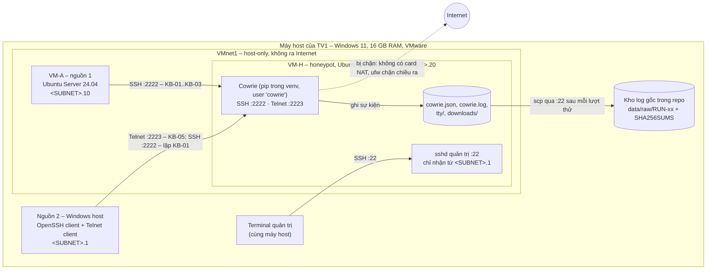

# Sơ đồ lab và chính sách cách ly (WP-02)

**Người làm:** TV1 · **Trạng thái:** bản thiết kế, chờ TV3 review theo checklist RV-THIẾT-KẾ · Các ô `<...>` điền khi dựng thật

## 1. Máy và tài nguyên

| Thành phần | Cấu hình |
| --- | --- |
| Máy host | Máy của TV1, Windows 11, **16 GB RAM**, VMware Workstation `<phiên bản>` |
| **VM-H** – honeypot | Ubuntu Server 24.04 LTS (có Python 3.12, đủ yêu cầu Python ≥ 3.11 của Cowrie), 2 GB RAM, 2 vCPU, 20 GB đĩa, không cài giao diện |
| **VM-A** – nguồn 1 | Ubuntu Server 24.04 LTS, 2 GB RAM, 1 vCPU, 15 GB đĩa |
| **Host** – nguồn 2 | Chính máy Windows, nối vào lab qua card mạng ảo VMnet1 |

Hai VM dùng tổng 4 GB RAM; host còn khoảng 12 GB nên chạy song song thoải mái.

## 2. Mạng

Lab dùng mạng **host-only VMnet1** của VMware: các VM và máy host nói chuyện được với nhau, nhưng **không có đường ra Internet**.

**Cách xem dải IP:** mở VMware → Edit → Virtual Network Editor → VMnet1 → xem "Subnet IP". Hoặc trên Windows chạy `ipconfig` và tìm "VMware Network Adapter VMnet1". Gọi dải đó là `<SUBNET>`, ví dụ `192.168.x.0/24`.

| Máy | Địa chỉ IP | Cách đặt |
| --- | --- | --- |
| Host (nguồn 2) | `<SUBNET>.1` | VMware tự gán cho VMnet1 |
| VM-A (nguồn 1) | `<SUBNET>.10` | Đặt IP tĩnh bằng netplan |
| VM-H (honeypot) | `<SUBNET>.20` | Đặt IP tĩnh bằng netplan |

Dùng IP tĩnh để IP không đổi giữa các lượt thử; bảng đối chiếu nhật ký ↔ log dựa vào IP nguồn.

**Card mạng của từng VM:**

| VM | Khi cài đặt | Khi thử nghiệm |
| --- | --- | --- |
| VM-H | **NAT (VMnet8)** để tải gói và cài Cowrie | Đổi sang **Host-only (VMnet1)**. Không còn card NAT |
| VM-A | Host-only (VMnet1). Chỉ bật NAT tạm nếu thiếu gói, rồi tắt | Host-only (VMnet1) |

## 3. Sơ đồ



## 4. Ai được kết nối tới đâu

| Từ | Tới | Cổng | Cho phép | Mục đích |
| --- | --- | --- | --- | --- |
| VM-A, Host | VM-H | 2222/tcp, 2223/tcp | Có | Tương tác với honeypot |
| Host | VM-H | 22/tcp | Có | Quản trị, lấy log |
| VM-A | VM-H | 22/tcp | **Không** | Nguồn thử nghiệm không được chạm cổng quản trị |
| VM-H | VM-A | 8000/tcp | Chỉ khi chạy KB-04 | Shell giả tải tệp vô hại |
| VM-H | Bất kỳ đâu khác | – | **Không** | Honeypot không được tự kết nối ra ngoài |

## 5. Luật firewall trên VM-H (ufw)

Áp dụng **sau khi** cài xong Cowrie và đổi card mạng sang host-only:

```bash
sudo ufw default deny incoming
sudo ufw default deny outgoing
sudo ufw allow in from <SUBNET>.1 to any port 22 proto tcp
sudo ufw allow in from <SUBNET>.0/24 to any port 2222 proto tcp
sudo ufw allow in from <SUBNET>.0/24 to any port 2223 proto tcp
# Chỉ bật khi chạy KB-04, xong thì xóa:
# sudo ufw allow out to <SUBNET>.10 port 8000 proto tcp
sudo ufw enable
sudo ufw status verbose
```

ufw cho phép gói trả lời của các kết nối đã được nhận vào, nên không cần mở thêm chiều ra cho cổng 22, 2222 và 2223. Muốn chặn cả VM-A vào cổng 22 thì chỉ cần không có luật cho phép; luật dòng 3 chỉ mở cho IP host.

## 6. Các lớp cách ly

Theo nguyên tắc defense in depth: một lớp hỏng thì vẫn còn lớp khác.

1. **Mạng:** VM-H không có card NAT khi thử nghiệm, nên không có đường ra Internet kể cả khi firewall lỗi.
2. **Firewall:** ufw chặn chiều ra theo mặc định.
3. **VMware:** tắt Shared Folders, kéo-thả và copy-paste giữa host và VM-H (VM Settings → Options). Các tính năng này là đường đi tắt từ VM sang máy host.
4. **Quyền:** Cowrie chạy bằng user riêng `cowrie`, không phải root; cổng 2222 và 2223 không cần root.
5. **Khôi phục:** chụp snapshot VM-H ngay sau khi cài xong và áp firewall. Lab có sự cố thì quay về snapshot.
6. **Thói quen:** tắt VM-H khi không dùng; không đưa mật khẩu thật hay khóa cá nhân vào VM.

## 7. Đường đi của log

1. Cowrie ghi vào `~cowrie/var/log/cowrie/cowrie.json` trên VM-H. Đường dẫn chính xác tùy thư mục chạy `cowrie init`; ghi lại vào README khi cài.
2. Sau mỗi lượt thử, từ máy host chạy `scp` qua cổng 22 để lấy log và thư mục `tty/` về `data/raw/RUN-xx/`.
3. Tính SHA-256 và lưu vào `SHA256SUMS`. Từ đây không sửa file trong `raw/`.

## 8. Còn phải điền khi dựng thật

- [ ] Phiên bản VMware Workstation
- [ ] Dải `<SUBNET>` của VMnet1
- [ ] Đường dẫn log thực tế trên VM-H
- [ ] Windows host đã có Telnet client chưa (Windows Features → Telnet Client, hoặc dùng PuTTY)
